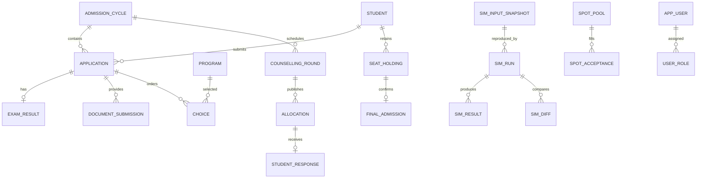

# College Admission Management System
### *The admission system you can audit*

**Team:** Arshdeep's team · **Course:** Advanced Database Management Systems · **Plan v2:** 4 November 2026

> **Working assumptions (change these once confirmed):** PostgreSQL 16 · 4 team members · ~8 weeks.
> **Version note:** v2 preserves the original plan, with corrections in place and missing requirements added in Appendix C. SQL is illustrative design material, not a completed application. The course rubric has not been provided.
>
> If the course requires Oracle or MySQL, see [Appendix B](#appendix-b-oracle-and-mysql-equivalents). Nearly every idea carries over.

---

## Contents

1. [The thesis](#1-the-thesis)
2. [What everyone else builds vs. what we build](#2-what-everyone-else-builds-vs-what-we-build)
3. [System overview](#3-system-overview)
4. [Data model](#4-data-model)
5. [Module 1: The allocation engine](#5-module-1-the-allocation-engine)
6. [Module 2: "Why didn't I get CSE?"](#6-module-2-why-didnt-i-get-cse)
7. [Module 3: Tamper-evident ledger and time travel](#7-module-3-tamper-evident-ledger-and-time-travel)
8. [Module 4: The last-seat race](#8-module-4-the-last-seat-race)
9. [**Module 5: What-if sandbox and chance predictor (deep dive)**](#9-module-5-what-if-sandbox-and-chance-predictor-deep-dive)
10. [Demo-day script](#10-demo-day-script)
11. [Timeline and team split](#11-timeline-and-team-split)
12. [Risks and how we handle them](#12-risks-and-how-we-handle-them)
13. [Appendix A: Synthetic data](#appendix-a-synthetic-data)
14. [Appendix B: Oracle and MySQL equivalents](#appendix-b-oracle-and-mysql-equivalents)
15. [Appendix C: Implementation requirements added in v2](#appendix-c--implementation-requirements-added-in-v2)
16. [Appendix D: v2 corrections and technical references](#appendix-d--v2-corrections-and-technical-references)

---

## 1. The thesis

Most "College Admission Management System" projects are CRUD apps: a student fills a form, an admin clicks approve, a dashboard shows counts. The database is just storage.

**Ours puts the database at the centre.** It allocates seats fairly, explains every decision, proves nobody tampered with the results, survives a stampede of simultaneous requests, and lets administrators safely ask "what if?" before they change anything.

Five promises, each backed by a module:

| Promise | What it means | Module |
|---|---|---|
| **Fair** | Seats are allocated by a provably stable matching algorithm with explicitly defined reservation rules for this academic model | 1 |
| **Explainable** | Any student can ask why they didn't get a program and get a precise, data-backed answer | 2 |
| **Transparent** | Every change is hash-chained; history is queryable at any past moment | 3 |
| **Reliable** | Under heavy concurrent load, no seat is ever double-booked | 4 |
| **Foresighted** | Admins test policy changes without touching live data; students see realistic chances | 5 |

**One-line pitch for the viva:** *"Anyone can store admission data. Our database can prove its decisions were fair."*

---

## 2. What everyone else builds vs. what we build

| Typical project | Our project | ADBMS concepts shown |
|---|---|---|
| Admin approves/rejects forms | Multi-round counselling with stable matching and reservations | Stored procedures, set-based iteration, window functions |
| Status column says "Rejected" | Decision trace that explains every rejection | Data lineage, row-level security |
| `updated_at` column | Hash-chained audit ledger + system-time version history | Triggers, cryptographic functions, range types, exclusion constraints |
| Works for one user at a time | Capacity invariants tested with 500 competing requests | Isolation levels, row locks, MVCC, deadlock handling |
| Static reports | Transactional what-if simulation + statistical cutoff projection | Temp tables, subtransactions, recursive CTEs, materialized views, regression aggregates |

---

## 3. System overview

### 3.1 Actors

- **Student**: registers, uploads documents, fills a ranked list of program choices, responds after each round (Freeze / Float / Slide / Withdraw), asks "why not me?", checks chances.
- **Admission admin**: manages seat matrix, runs and publishes rounds, verifies the ledger.
- **Sandbox analyst** (may be the same person as admin, but a separate role): runs what-if scenarios. Cannot publish.
- **Auditor** (read-only): verifies the hash chain, runs time-travel queries.

### 3.2 Admission lifecycle

```
Registration ──► Document verification ──► Choice filling window ──► Choice lock
                                                │                          │
                                     (nightly mock allotment)              ▼
                                                                    Round 1 allocation
                                                                           │
                         ┌─────────────────────────────────────────────────┘
                         ▼
               Student responses: FREEZE / FLOAT / SLIDE / WITHDRAW
                         │
                         ▼
               Round 2 … Round N  ──►  Spot round (first-come vacancy filling)  ──►  Final admission
```

### 3.3 Architecture

```
┌──────────────────────────────┐
│  Web UI (student + admin)    │   thin: forms, tables, charts
└──────────────┬───────────────┘
               │ HTTPS / JSON
┌──────────────▼───────────────┐
│  API layer (FastAPI or Node) │   thin: auth, calls DB functions, no business logic
└──────────────┬───────────────┘
               │ SQL (calls functions/procedures)
┌──────────────▼──────────────────────────────────────────────────┐
│  PostgreSQL 16  ← the brain                                      │
│  • run_allocation()   • why_not()   • ledger triggers            │
│  • history triggers   • accept_spot_seat()   • mv_cutoff_trend   │
│  • RLS policies       • roles: student / admin / analyst / auditor│
└──────────────────────────────────────────────────────────────────┘
```

**Design rule:** business logic lives in the database. The API only authenticates and forwards. That way the database itself is what we're demonstrating, and the evaluator can see every rule in SQL.

---

## 4. Data model

Core tables (abbreviated; full DDL goes in `schema.sql`). Appendix C supplies missing entities, constraints and indexes. These examples must be combined with implemented helpers, triggers, grants and migrations before use as a complete system.

```sql
CREATE TYPE seat_cat AS ENUM ('OPEN', 'EWS', 'OBC_NCL', 'SC', 'ST');

CREATE TABLE student (
  student_id   bigserial PRIMARY KEY,
  full_name    text NOT NULL,
  dob          date NOT NULL,
  gender       char(1) CHECK (gender IN ('M','F','X')),
  category     seat_cat NOT NULL,
  is_pwd       boolean NOT NULL DEFAULT false,
  documents    jsonb NOT NULL DEFAULT '{}'      -- flexible, varies by board/state
);

CREATE TABLE exam_result (
  student_id   bigint NOT NULL REFERENCES student,
  year         int NOT NULL,
  total_marks  numeric(6,2) NOT NULL,
  maths        numeric(5,2), physics numeric(5,2), chemistry numeric(5,2),
  crl_rank     int NOT NULL CHECK (crl_rank > 0), -- common rank list for this year
  cat_rank     int CHECK (cat_rank > 0),          -- rank within own category
  PRIMARY KEY (student_id, year),
  UNIQUE (year, crl_rank)
);

CREATE TABLE program (
  program_id   serial PRIMARY KEY,
  institute    text NOT NULL,
  code         text NOT NULL,                   -- e.g. 'CSE', 'ECE'
  name         text NOT NULL,
  UNIQUE (institute, code)                       -- multiple institutes can offer CSE
);

-- "Dense" seat matrix: one row for EVERY program × category, even when seats = 0.
-- This makes the sandbox (Module 5) trivial: changing seats is always an UPDATE, never an INSERT.
CREATE TABLE seat_matrix (
  year          int NOT NULL,
  program_id    int NOT NULL REFERENCES program,
  seat_category seat_cat NOT NULL,
  seats         int NOT NULL CHECK (seats >= 0),
  PRIMARY KEY (year, program_id, seat_category)
);

CREATE TABLE choice (
  student_id   bigint REFERENCES student,
  year         int NOT NULL,
  pref_order   smallint NOT NULL CHECK (pref_order > 0),
  program_id   int NOT NULL REFERENCES program,
  PRIMARY KEY (student_id, year, pref_order),
  UNIQUE (student_id, year, program_id),
  FOREIGN KEY (student_id, year) REFERENCES exam_result (student_id, year)
);

CREATE TABLE counselling_round (
  round_id     serial PRIMARY KEY,
  year         int NOT NULL,
  round_no     smallint NOT NULL,
  status       text NOT NULL CHECK (status IN ('CHOICES_OPEN','LOCKED','PUBLISHED','CLOSED')),
  published_at timestamptz,
  UNIQUE (year, round_no)
);

CREATE TABLE allocation (
  round_id      int REFERENCES counselling_round,
  student_id    bigint REFERENCES student,
  program_id    int NOT NULL REFERENCES program,
  seat_category seat_cat NOT NULL,
  pref_order    smallint NOT NULL,
  rank_used     int NOT NULL,
  PRIMARY KEY (round_id, student_id)
);

CREATE TABLE allocation_trace (           -- powers Module 2
  round_id      int REFERENCES counselling_round,
  student_id    bigint REFERENCES student,
  pref_order    smallint,
  program_id    int REFERENCES program,
  seat_category seat_cat,
  outcome       text CHECK (outcome IN ('ALLOTTED','REJECTED_FULL','NOT_REACHED')),
  closing_rank  int,                       -- last rank admitted to that seat pool
  PRIMARY KEY (round_id, student_id, pref_order, seat_category)
);

CREATE TABLE student_response (
  round_id     int NOT NULL, student_id bigint NOT NULL,
  decision     text NOT NULL CHECK (decision IN ('FREEZE','FLOAT','SLIDE','WITHDRAW')),
  responded_at timestamptz NOT NULL DEFAULT now(),
  PRIMARY KEY (round_id, student_id),
  FOREIGN KEY (round_id, student_id) REFERENCES allocation (round_id, student_id)
);

CREATE TABLE audit_ledger (               -- Module 3
  seq        bigserial PRIMARY KEY,
  at         timestamptz NOT NULL DEFAULT clock_timestamp(),
  actor      text NOT NULL DEFAULT session_user,
  entity     text NOT NULL,
  op         text NOT NULL,
  payload    jsonb NOT NULL,
  prev_hash  bytea,
  hash       bytea NOT NULL
);

-- Module 5 tables are defined in section 9.
```

**ER summary:** `student 1—N exam_result` (one result per student per year), `student 1—N choice N—1 program`, `program 1—N seat_matrix`, `counselling_round 1—N allocation N—1 student`, `allocation_trace` is the explanation of `allocation`.

---

## 5. Module 1: The allocation engine

### 5.1 The idea

Use **student-proposing deferred acceptance** (Gale–Shapley):

1. Every unassigned student "proposes" to their next choice.
2. Every seat pool tentatively holds its best-ranked applicants up to capacity and rejects the rest.
3. Rejected students propose to their next choice. Repeat until nobody is rejected.

With fixed independent pools and strict priorities, the result is **stable**: no eligible student and pool form a blocking pair. Student-proposing deferred acceptance is **strategy-proof** in this model when complete preference lists are allowed. National-policy compliance and advanced reservation rules require separate validation.

### 5.2 Reservations: "virtual programs"

Each program is split into seat pools: `CSE-OPEN`, `CSE-OBC_NCL`, `CSE-SC`, and so on. A student's list is expanded so that for every program they try **OPEN first, then their own category**:

```
Diya (OBC_NCL) lists:  CSE, ECE
Expanded list:         CSE-OPEN, CSE-OBC_NCL, ECE-OPEN, ECE-OBC_NCL
```

This models the open-merit principle that a reserved-category student who makes it on open merit takes an OPEN seat and does not use up a reserved one. OPEN pools rank by `crl_rank`, category pools by `cat_rank`.

*Stretch:* PwD and female-supernumerary rules need a separate policy and validation. Horizontal reservations, overlapping eligibility and seat conversion must not be assumed correct merely by adding virtual pools.

### 5.3 Rounds

Before Round k+1, student responses filter the expanded lists:

- **FREEZE**: retain the allocation outside the active solver; subtract that occupied seat from capacity.
- **FLOAT**: retain eligible higher program choices, followed by the exact current pool as a fallback.
- **SLIDE**: retain eligible higher choices at the same institute, followed by the exact current pool as a fallback.
- **WITHDRAW**: remove the student and release the seat for the next round.

Preserve original expanded preference positions when filtering lists. Appendix C specifies deadlines, missing responses, seat retention and publication invariants.

The engine itself (section 9.5) is the same procedure for every round; only the input lists change.

---

## 6. Module 2: "Why didn't I get CSE?"

During allocation, the engine writes a trace row for every choice a student had above the seat they got. After the round:

```sql
CREATE FUNCTION why_not(p_round int, p_student bigint)
RETURNS TABLE (pref_order smallint, program text, seat_pool seat_cat,
               your_rank int, closing_rank int, verdict text)
LANGUAGE sql STABLE AS $$
  SELECT t.pref_order, p.code, t.seat_category,
         CASE WHEN t.seat_category = 'OPEN' THEN r.crl_rank ELSE r.cat_rank END,
         t.closing_rank,
         CASE t.outcome
           WHEN 'ALLOTTED'      THEN 'Allotted'
           WHEN 'REJECTED_FULL' THEN format('Full: last seat went to rank %s', t.closing_rank)
           ELSE 'Not reached: you were placed higher on your list'
         END
  FROM allocation_trace t
  JOIN program p     USING (program_id)
  JOIN counselling_round cr ON cr.round_id = t.round_id
  JOIN exam_result r ON r.student_id = t.student_id AND r.year = cr.year
  WHERE t.round_id = p_round AND t.student_id = p_student
  ORDER BY t.pref_order, CASE WHEN t.seat_category = 'OPEN' THEN 0 ELSE 1 END;
$$;
```

**Privacy:** row-level security so a student can only read their own trace. The API must supply the authenticated identity; clients cannot choose `app.student_id` or receive SQL access. This policy alone does not authenticate users. Appendix C defines the security boundary.

```sql
ALTER TABLE allocation_trace ENABLE ROW LEVEL SECURITY;
CREATE POLICY own_trace ON allocation_trace FOR SELECT TO student_role
  USING (student_id = NULLIF(current_setting('app.student_id', true), '')::bigint);
```

The UI turns the result into a sentence: *"Your OBC-NCL rank was 4,312. The last OBC-NCL seat in CSE went to rank 4,190. You were allotted ECE, your 2nd preference."*

---

## 7. Module 3: Tamper-evident ledger and time travel

### 7.1 Hash chain

Every insert/update/delete on `seat_matrix`, `allocation`, `exam_result` and `student_response` fires an AFTER ROW trigger that appends to `audit_ledger`. The complete implementation also audits choices, eligibility decisions, round transitions and simulation summaries. Each entry's hash covers the previous entry's hash, so editing any old row breaks every hash after it.

```sql
CREATE FUNCTION ledger_append() RETURNS trigger LANGUAGE plpgsql AS $$
DECLARE v_prev bytea; v_payload jsonb;
BEGIN
  PERFORM pg_advisory_xact_lock(4242);   -- serialise appends so "previous hash" is unambiguous
  SELECT hash INTO v_prev FROM audit_ledger ORDER BY seq DESC LIMIT 1;
  v_payload := jsonb_build_object('old', to_jsonb(OLD), 'new', to_jsonb(NEW));
  INSERT INTO audit_ledger (entity, op, payload, prev_hash, hash)
  VALUES (TG_TABLE_NAME, TG_OP, v_payload, v_prev,
          sha256(coalesce(v_prev, '') || convert_to(TG_TABLE_NAME || TG_OP || v_payload::text, 'UTF8')));
  RETURN NULL;                         -- appropriate for an AFTER ROW trigger
END $;
```

**v2 integrity requirement:** the example does not hash its actor or timestamp. The complete trigger must hash the canonical event, including sequence, timestamp, actor ID, entity, operation, payload and previous hash; serialize through a protected chain-head row and checkpoint the head outside the database. A privileged operator who can rewrite the whole chain can otherwise recalculate it. This is tamper-evident, not tamper-proof.

**Verification query:** recompute each hash with a window function (`LAG(hash) OVER (ORDER BY seq)`) and report the first `seq` where the stored hash doesn't match. Demo: an "insider" runs a raw `UPDATE audit_ledger SET payload = ...`, the verifier flags the exact row.

### 7.2 Time travel

History tables store every version of a row with a system-time validity period. This is system-time history; bitemporal history would also need a separate business-valid-time dimension.

```sql
CREATE EXTENSION btree_gist;
CREATE TABLE seat_matrix_history (
  LIKE seat_matrix,
  valid tstzrange NOT NULL,
  EXCLUDE USING gist (year WITH =, program_id WITH =, seat_category WITH =, valid WITH &&)
);
-- "What did the CSE seat matrix look like at 3 PM on Round 2 day?"
SELECT * FROM seat_matrix_history
WHERE program_id = 1 AND valid @> timestamptz '2026-07-02 15:00+05:30';
```

The exclusion constraint guarantees two versions of the same row can never overlap in time.

---

## 8. Module 4: The last-seat race

**Where it happens for real:** the spot round, where leftover vacant seats are offered first-come, first-served to eligible students.

### 8.1 The broken version (demo this first)

```sql
-- application code does "check, then insert" under READ COMMITTED
SELECT count(*) FROM spot_acceptance WHERE pool_id = 7;   -- everyone sees 0 of 1 taken
INSERT INTO spot_acceptance (pool_id, student_id) VALUES (7, :me);
```

Use `pgbench -c 50 -j 8 -t 10 -f naive_accept.sql` for 500 attempts across 50 concurrent clients. Use `-c 500 -j 8 -t 1` for 500 concurrent clients only on a test instance configured for that connection count. Coordinate the broken check/insert with a test barrier to reproduce the race; an uncontrolled run need not overbook every time. The v1 command (`-c 200 -t 3`) meant 600 attempts across 200 clients.

### 8.2 Four lines of defence (demo the fix)

1. **Row lock:** `SELECT seats_left FROM spot_pool WHERE pool_id = 7 FOR UPDATE;` serialises contenders on that one row.
2. **Atomic conditional update** (the cleanest):
   ```sql
   UPDATE spot_pool SET seats_left = seats_left - 1
   WHERE pool_id = 7 AND seats_left > 0
   RETURNING pool_id;   -- zero rows returned = you lost the race
   ```
3. **SERIALIZABLE + retry loop** for the general case.
4. **`CHECK (seats_left >= 0)`** prevents a negative counter. Extra acceptance rows must also be prevented: revoke direct writes and combine the counter update and acceptance insert in one transaction, with one active holding per student and an idempotency key.

With 500 distinct eligible contenders and one available seat, verify one committed acceptance and 499 clean no-seat outcomes. Report measured deadlocks, retries and failures; do not promise zero deadlocks in advance.

---

## 9. Module 5: What-if sandbox and chance predictor (deep dive)

This module has two halves:

- **5A: The admin what-if sandbox.** "What happens if we add 10 seats to CSE?" Run the real allocation engine on a hypothetical, measure the ripple effect, and leave live data untouched.
- **5B: The student chance predictor.** "With my rank, what are my chances at each program?" Statistical projection from past years, plus mock allotment from the same engine.

Both are powered by a single idea.

### 9.1 Core principle: *every run is a simulation*

We don't write a "real" allocator and a separate "simulator". There is **one** procedure, `run_allocation()`:

```
            ┌────────────── run_allocation(year, round, scenario, publish) ───────────────┐
 live data  │  1. SNAPSHOT  live tables ──► private temp tables (w_seats, w_choice, …)   │
 (read only)│  2. APPLY     scenario overrides to the temp tables                         │
            │  3. SOLVE     deferred acceptance on the temp tables                        │
            │  4. VERIFY    stability check (+ monotonicity check if seats only added)    │
            │  5. PERSIST   results into sim_run / sim_result                             │
            │  6. PUBLISH?  only if publish = true AND scenario is empty                  │
            └─────────────────────────────────────────────────────────────────────────────┘
```

**A live round is just a simulation with no changes that gets published.** This gives us:

- **No code duplication.** The sandbox can never drift from the real engine, because it *is* the real engine.
- **Every live round is reproducible.** Preserve immutable input snapshots, engine/policy versions and seed with each run (Appendix C); saved outputs alone are insufficient.
- **Safety by construction.** Steps 1–5 only *read* live tables. Only step 6 writes, and it refuses modified scenarios.

### 9.2 Three ways to build a sandbox (and why we pick the third)

This comparison is a strong viva section on its own. It shows we understand transactions rather than just using them.

#### Option A: `BEGIN … ROLLBACK` on live tables (the naive approach)

```sql
BEGIN;
UPDATE seat_matrix SET seats = seats + 10
 WHERE year = 2026 AND program_id = 1 AND seat_category = 'OPEN';
SELECT run_allocation(2026, 1);         -- engine sees the extra seats
SELECT * FROM sim_run ORDER BY sim_id DESC LIMIT 1;       -- read metadata NOW
ROLLBACK;                                -- seats back to normal
```

| ✅ Good | ❌ Bad |
|---|---|
| Atomicity demo in 5 lines: change, observe, undo | The `UPDATE` holds a **row lock** on the CSE row until rollback. Anyone editing that seat row during a 5-second simulation waits |
| Others never see the change (no dirty reads in PostgreSQL) | `ROLLBACK` also deletes the simulation's results, so you must read everything before rolling back |
| | You can't keep scenarios to compare later |

**Verdict:** perfect as a 1-minute **teaching demo** in the viva ("here's the naive way and here's why it's wrong"). Not how we build it.

#### Option B: PL/pgSQL subtransaction trick

In PL/pgSQL, a `BEGIN … EXCEPTION … END` block runs as a **subtransaction** (an implicit savepoint). If an exception is caught, all database changes inside the block are undone, **but local variables keep their values.** So we can make changes, run the engine, copy results into a variable, then deliberately throw:

```sql
CREATE FUNCTION what_if_subtxn(p_scenario jsonb) RETURNS jsonb
LANGUAGE plpgsql AS $$
DECLARE v_summary jsonb;
BEGIN
  BEGIN                                            -- subtransaction starts
    UPDATE seat_matrix s SET seats = s.seats + (c->>'delta')::int
    FROM jsonb_array_elements(p_scenario->'seat_changes') c
    WHERE s.year = 2026 AND s.program_id = (c->>'program_id')::int
      AND s.seat_category = (c->>'seat_category')::seat_cat;

    PERFORM run_allocation(2026, 1);
    SELECT to_jsonb(x) INTO v_summary FROM sim_run x ORDER BY sim_id DESC LIMIT 1;

    RAISE EXCEPTION USING ERRCODE = 'SB001', MESSAGE = 'sandbox rollback';
  EXCEPTION WHEN SQLSTATE 'SB001' THEN
    NULL;                                          -- every change above is undone
  END;                                             -- v_summary still holds the results
  RETURN v_summary;
END $$;
```

We use a **custom SQLSTATE (`SB001`)** so we only swallow our own deliberate rollback, never a genuine error from inside the engine.

**Verdict:** clever and very "advanced DBMS", and great to show in the report. But it still takes row locks on live tables during the run, and the summary is all that survives.

#### Option C: Private temp working tables ✅ (chosen)

The engine copies what it needs into **temporary tables**, which are private to the database session. Scenarios modify those copies, never live rows.

| Property | Why it holds |
|---|---|
| Avoids row locks on live admission data | Ordinary SELECT reads use MVCC; table locks, schema changes, shared resources and ledger writes may still cause contention |
| Five admins can simulate at once | Temp tables are per-session; same names, separate data, no collisions |
| Results are kept | Written to permanent `sim_run` / `sim_result` tables, so scenarios can be compared later |
| Consistent input | The whole snapshot is taken inside one `REPEATABLE READ` transaction (section 9.8) |

### 9.3 Sandbox tables

```sql
CREATE TABLE sim_run (
  sim_id       bigserial PRIMARY KEY,
  year         int NOT NULL,
  round_no     smallint NOT NULL,
  base_sim_id  bigint REFERENCES sim_run,     -- what this scenario is compared against
  label        text,
  scenario     jsonb NOT NULL DEFAULT '{}',
  run_by       text NOT NULL DEFAULT session_user,
  started_at   timestamptz NOT NULL DEFAULT clock_timestamp(),
  duration_ms  int,
  is_published boolean NOT NULL DEFAULT false,
  checks       jsonb                          -- results of stability / monotonicity checks
);

CREATE TABLE sim_result (
  sim_id        bigint REFERENCES sim_run ON DELETE CASCADE,
  student_id    bigint NOT NULL,
  program_id    int NOT NULL,
  seat_category seat_cat NOT NULL,
  pref_order    smallint NOT NULL,   -- position of the PROGRAM in the student's list
  k             smallint NOT NULL,   -- position in the EXPANDED list (program × pool)
  rank_used     int NOT NULL,
  PRIMARY KEY (sim_id, student_id)
);

CREATE TABLE sim_diff (
  sim_id        bigint REFERENCES sim_run ON DELETE CASCADE,
  student_id    bigint,
  base_program  int, base_cat seat_cat, base_pref smallint, base_k smallint,
  sim_program   int, sim_cat  seat_cat, sim_pref  smallint, sim_k  smallint,
  change_type   text,
  PRIMARY KEY (sim_id, student_id)
);
```

### 9.4 Scenario format (JSONB)

A scenario is a small JSON document. Store it with the immutable base input and engine/policy versions so results can be reproduced and audited.

```json
{
  "label": "Add 10 CSE open seats, withdraw Civil",
  "seat_changes": [
    { "program_id": 1, "seat_category": "OPEN", "delta": 10 },
    { "program_id": 2, "seat_category": "SC",   "delta": -1 }
  ],
  "withdraw_programs": [4],
  "withdrawal_rate": 0.05,
  "seed": "demo-2026"
}
```

| Field | Effect |
|---|---|
| `seat_changes` | Add or remove seats in any pool (deltas summed if a pool appears twice) |
| `withdraw_programs` | Program shut down: all its pools set to 0 |
| `withdrawal_rate` + `seed` | That fraction of students drop out, chosen deterministically (section 9.7) |
| *(stretch)* `tie_break` | Swap tie-break rules, e.g. maths-first vs. age-first |

### 9.5 The engine, step by step

**v2 implementation boundary:** the retained SQL is an engine sketch, not an installation script. The complete routine must also implement Appendix C: immutable input loading, authorization, scenario validation, round filters, trace generation, feasibility checks, monotonicity enforcement, simulation audit and atomic publication.

```sql
CREATE OR REPLACE FUNCTION run_allocation(
  p_year      int,
  p_round_no  int,
  p_scenario  jsonb   DEFAULT '{}',
  p_publish   boolean DEFAULT false,
  p_base_sim  bigint  DEFAULT NULL
) RETURNS bigint                       -- the new sim_id
LANGUAGE plpgsql
SECURITY DEFINER
SET search_path = pg_catalog, admission, pg_temp -- admission must be a trusted schema
AS $$
DECLARE
  v_sim_id bigint;
  v_t0     timestamptz := clock_timestamp();
  v_bad    int;
BEGIN
  -- ── Guardrails ──────────────────────────────────────────────────────────
  IF p_scenario IS NULL OR jsonb_typeof(p_scenario) <> 'object' THEN
    RAISE EXCEPTION 'Scenario must be a JSON object';
  END IF;
  IF p_publish AND p_scenario <> '{}'::jsonb THEN
    RAISE EXCEPTION 'A modified scenario can never be published';
  END IF;
  IF p_publish AND NOT admission.has_app_role('ADMIN') THEN
    RAISE EXCEPTION 'Only admission_admin may publish';
  END IF; -- protected app identity helpers are specified in Appendix C
  -- Pooled API implementation must lock by authenticated account ID (Appendix C).
  IF NOT pg_try_advisory_xact_lock(hashtext('sim:' || admission.current_app_user_id()::text)) THEN
    RAISE EXCEPTION 'You already have a simulation running';
  END IF;

  -- v2: this is the live-input branch; what-if/replay must load the stored base snapshot.
  -- ── 1. SNAPSHOT into private temp tables ────────────────────────────────
  CREATE TEMP TABLE w_seats ON COMMIT DROP AS
    SELECT program_id, seat_category, seats
    FROM seat_matrix WHERE year = p_year;

  CREATE TEMP TABLE w_choice ON COMMIT DROP AS
    SELECT ch.student_id,
           ROW_NUMBER() OVER (PARTITION BY ch.student_id
                              ORDER BY ch.pref_order, e.pool_order)::smallint AS k,
           ch.pref_order, ch.program_id, e.seat_category,
           CASE WHEN e.seat_category = 'OPEN' THEN r.crl_rank ELSE r.cat_rank END AS rank_used
    FROM choice ch
    JOIN student st     USING (student_id)
     JOIN application a ON a.student_id = ch.student_id AND a.year = ch.year
    JOIN exam_result r  ON r.student_id = ch.student_id AND r.year = ch.year
    CROSS JOIN LATERAL (VALUES ('OPEN'::seat_cat, 1), (a.admission_category, 2)) e(seat_category, pool_order)
    WHERE ch.year = p_year AND a.status = 'VERIFIED'
      AND (e.pool_order = 1 OR a.admission_category <> 'OPEN');   -- OPEN students get one pool per program
    -- (round 2+: responses filter w_choice here: FREEZE / FLOAT / SLIDE / WITHDRAW, see 5.3)

  CREATE TEMP TABLE w_state ON COMMIT DROP AS
    SELECT student_id, MIN(k)::smallint AS next_k, 'FREE'::text AS status
     FROM w_choice GROUP BY student_id;

  CREATE TEMP TABLE w_hold (
    student_id bigint PRIMARY KEY, program_id int, seat_category seat_cat,
    k smallint, rank_used int
  ) ON COMMIT DROP;

  CREATE UNIQUE INDEX ON w_choice (student_id, k);
  CREATE INDEX ON w_hold (program_id, seat_category, rank_used);
  ANALYZE w_seats; ANALYZE w_choice; ANALYZE w_state;   -- autovacuum never analyses temp tables!

  -- ── 2. APPLY the scenario to the copies ─────────────────────────────────
  -- Validate pool existence and reject negative resulting capacity before updating.
  UPDATE w_seats ws SET seats = ws.seats + d.delta
  FROM (
    SELECT (x->>'program_id')::int AS program_id,
           (x->>'seat_category')::seat_cat AS seat_category,
           SUM((x->>'delta')::int) AS delta          -- aggregate first: UPDATE … FROM uses
    FROM jsonb_array_elements(COALESCE(p_scenario->'seat_changes', '[]')) x   -- only ONE matching row
    GROUP BY 1, 2
  ) d
  WHERE ws.program_id = d.program_id AND ws.seat_category = d.seat_category;

  UPDATE w_seats SET seats = 0
  WHERE program_id IN (SELECT jsonb_array_elements_text(
                              COALESCE(p_scenario->'withdraw_programs', '[]'))::int);

  IF p_scenario ? 'withdrawal_rate' THEN
    DELETE FROM w_state s
    WHERE ('x' || substr(md5(s.student_id::text || ':' || (p_scenario->>'seed')), 1, 7))::bit(28)::int
          < (p_scenario->>'withdrawal_rate')::numeric * 268435456;      -- 2^28
  END IF;

  -- ── 3. SOLVE ────────────────────────────────────────────────────────────
  CALL da_solve();

  -- ── 4. VERIFY: no blocking pairs (section 9.6.4) ────────────────────────
  SELECT count(*) INTO v_bad FROM stability_violations();
  IF v_bad > 0 THEN
    RAISE EXCEPTION 'Engine bug: % blocking pairs found', v_bad;   -- whole run rolls back
  END IF;

  -- ── 5. PERSIST ──────────────────────────────────────────────────────────
  INSERT INTO sim_run (year, round_no, base_sim_id, label, scenario)
  VALUES (p_year, p_round_no, p_base_sim, p_scenario->>'label', p_scenario)
  RETURNING sim_id INTO v_sim_id;

  INSERT INTO sim_result
  SELECT v_sim_id, h.student_id, h.program_id, h.seat_category, c.pref_order, h.k, h.rank_used
  FROM w_hold h JOIN w_choice c ON c.student_id = h.student_id AND c.k = h.k;

  IF p_base_sim IS NOT NULL THEN
    PERFORM compute_diff(v_sim_id, p_base_sim);
  END IF;

  UPDATE sim_run SET duration_ms = (extract(epoch FROM clock_timestamp() - v_t0) * 1000)::int
  WHERE sim_id = v_sim_id;

  -- v2: persist input snapshot, trace, all checks and SIMULATE ledger event too.
  -- ── 6. PUBLISH (live rounds only) ──────────────────────────────────────
  IF p_publish THEN
    -- v2: acquire the round lock, validate LOCKED status, source revision, predecessor
    -- and absence of an existing publication before inserting (Appendix C).
    INSERT INTO allocation (round_id, student_id, program_id, seat_category, pref_order, rank_used)
    SELECT cr.round_id, r.student_id, r.program_id, r.seat_category, r.pref_order, r.rank_used
    FROM sim_result r
    JOIN counselling_round cr ON cr.year = p_year AND cr.round_no = p_round_no
    WHERE r.sim_id = v_sim_id;                     -- ledger trigger fires on these inserts
    UPDATE counselling_round SET status = 'PUBLISHED', published_at = clock_timestamp()
    WHERE year = p_year AND round_no = p_round_no;
    UPDATE sim_run SET is_published = true WHERE sim_id = v_sim_id;
    -- Results, round state, trace, publication flag and ledger commit atomically.
  END IF;

  RETURN v_sim_id;
END $$;
```

#### The solver: set-based deferred acceptance

The naive way loops student by student (slow, very "programming"). We do it **set-based**: every iteration, *all* free students propose at once, and *all* seat pools trim at once with a window function. Measure iteration counts and runtime at 20,000 students; performance depends on the input.

```sql
CREATE OR REPLACE PROCEDURE da_solve() LANGUAGE plpgsql AS $$
DECLARE v_rejected int;
BEGIN
  LOOP
    -- (1) all FREE students propose to their next choice
    WITH prop AS (
      INSERT INTO w_hold (student_id, program_id, seat_category, k, rank_used)
      SELECT c.student_id, c.program_id, c.seat_category, c.k, c.rank_used
      FROM w_state s
      JOIN w_choice c ON c.student_id = s.student_id AND c.k = s.next_k
      WHERE s.status = 'FREE'
      RETURNING student_id
    )
    UPDATE w_state s SET status = 'HELD' FROM prop p WHERE p.student_id = s.student_id;

    -- anyone still FREE had no next choice left
    UPDATE w_state SET status = 'EXHAUSTED' WHERE status = 'FREE';

    -- (2) every pool keeps its best `seats` holders, rejects the rest
    WITH ranked AS (
      SELECT h.student_id, h.k,
             ROW_NUMBER() OVER (PARTITION BY h.program_id, h.seat_category
                                ORDER BY h.rank_used, h.student_id) AS rn,
             COALESCE(ws.seats, 0) AS seats            -- LEFT JOIN: a pool with no row has 0 seats
      FROM w_hold h
      LEFT JOIN w_seats ws USING (program_id, seat_category)
    ), rejected AS (
      DELETE FROM w_hold h USING ranked r
      WHERE h.student_id = r.student_id AND r.rn > r.seats
      RETURNING h.student_id, h.k
    )
    UPDATE w_state s SET status = 'FREE', next_k = (SELECT MIN(c.k) FROM w_choice c
                WHERE c.student_id = s.student_id AND c.k > r.k)
    FROM rejected r WHERE r.student_id = s.student_id;
    GET DIAGNOSTICS v_rejected = ROW_COUNT;

    EXIT WHEN v_rejected = 0;          -- nobody rejected → matching is stable
  END LOOP;
END $$;
```

Concepts packed in here: **data-modifying CTEs** (`INSERT … RETURNING` feeding an `UPDATE` in one statement), **window functions** for capacity trimming, `GET DIAGNOSTICS` for loop control. (In the real build, the `rejected` CTE also inserts `REJECTED_FULL` rows into the trace table for Module 2.)

### 9.6 Measuring the impact

A simulation is only useful if it tells you *what changed*. Four outputs.

#### 9.6.1 Student-level diff

```sql
CREATE OR REPLACE FUNCTION compute_diff(p_sim bigint, p_base bigint) RETURNS void
LANGUAGE sql AS $$
  INSERT INTO sim_diff
  SELECT p_sim,
         COALESCE(b.student_id, s.student_id),
         b.program_id, b.seat_category, b.pref_order, b.k,
         s.program_id, s.seat_category, s.pref_order, s.k,
         CASE
           WHEN b.student_id IS NULL                         THEN 'NEW_SEAT'
           WHEN s.student_id IS NULL                         THEN 'LOST_SEAT'
           WHEN b.program_id = s.program_id
            AND b.seat_category = s.seat_category            THEN 'UNCHANGED'
           WHEN b.program_id = s.program_id                  THEN 'POOL_SHIFT'   -- e.g. OBC → OPEN, same program
           WHEN s.pref_order < b.pref_order                  THEN 'UPGRADED'
           ELSE                                                   'DOWNGRADED'
         END
  FROM      (SELECT * FROM sim_result WHERE sim_id = p_base) b
  FULL JOIN (SELECT * FROM sim_result WHERE sim_id = p_sim)  s ON s.student_id = b.student_id;
$$;
```

The `FULL JOIN` is the key: students who gained or lost a seat appear on only one side.

**Admin summary card:**

```sql
SELECT change_type, count(*) FROM sim_diff
WHERE sim_id = :sim AND change_type <> 'UNCHANGED'
GROUP BY change_type ORDER BY count(*) DESC;
```

#### 9.6.2 Closing-rank shifts

The number admins actually care about: *how did cutoffs move?*

```sql
WITH closing AS (
  SELECT sim_id, program_id, seat_category, MAX(rank_used) AS closing_rank, COUNT(*) AS filled
  FROM sim_result WHERE sim_id IN (:base, :sim)
  GROUP BY 1, 2, 3
)
SELECT p.code, COALESCE(b.seat_category, s.seat_category) AS pool,
       b.closing_rank AS before, s.closing_rank AS after,
       s.closing_rank - b.closing_rank AS shift
FROM      (SELECT * FROM closing WHERE sim_id = :base) b
FULL JOIN (SELECT * FROM closing WHERE sim_id = :sim)  s USING (program_id, seat_category)
JOIN program p ON p.program_id = COALESCE(b.program_id, s.program_id)
WHERE b.closing_rank IS DISTINCT FROM s.closing_rank
ORDER BY abs(COALESCE(s.closing_rank - b.closing_rank, 0)) DESC;
```

`IS DISTINCT FROM` handles NULLs correctly (a pool that becomes empty or newly filled).

#### 9.6.3 The ripple chain (recursive CTE) ⭐

This is the most visually impressive output. Adding seats to CSE doesn't just help a few students: each student who moves *up* into CSE frees their old ECE seat, which pulls someone up from ME, which frees an ME seat… A **vacancy chain**.

```sql
WITH RECURSIVE moves AS (
  SELECT student_id,
         (base_program, base_cat) AS left_pool,
         (sim_program,  sim_cat)  AS joined_pool
  FROM sim_diff
  WHERE sim_id = :sim AND change_type IN ('UPGRADED','NEW_SEAT','POOL_SHIFT')
),
chain AS (
  -- seeds: students who moved INTO a pool the admin changed
  SELECT m.student_id, m.left_pool, m.joined_pool,
         1 AS depth, ARRAY[m.student_id] AS path
  FROM moves m
  WHERE m.joined_pool IN (
    SELECT ((x->>'program_id')::int, (x->>'seat_category')::seat_cat)
    FROM sim_run, jsonb_array_elements(scenario->'seat_changes') x
    WHERE sim_id = :sim
  )
  UNION ALL
  -- next link: someone who moved INTO the pool the previous student LEFT
  SELECT n.student_id, n.left_pool, n.joined_pool,
         c.depth + 1, c.path || n.student_id
  FROM chain c
  JOIN moves n ON n.joined_pool = c.left_pool
  WHERE NOT n.student_id = ANY (c.path)        -- cycle guard
    AND c.depth < 50                           -- safety cap
)
SELECT depth, student_id, left_pool, joined_pool, path
FROM chain ORDER BY path;
```

UI output: *"+1 CSE-OPEN seat → Kunal moves ECE→CSE → Tara moves ME→ECE → Dev gets ME (previously no seat). Ripple depth 3, 3 students helped."* The planned interactive page will display this result. Without vacancy tokens recorded during solving, the CTE shows possible pool-level links rather than a unique causal chain; label the visualization accordingly.

#### 9.6.4 Correctness checks built into every run

**Stability check.** A *blocking pair* is a student who prefers some pool to what they got, where that pool either has a free seat or holds someone ranked worse. Zero rows means the matching is stable. Run on every simulation; a non-zero count aborts the run.

```sql
CREATE OR REPLACE FUNCTION stability_violations()
RETURNS TABLE (student_id bigint, program_id int, seat_category seat_cat)
LANGUAGE sql AS $$
  SELECT c.student_id, c.program_id, c.seat_category
  FROM w_choice c
  LEFT JOIN w_hold mine ON mine.student_id = c.student_id
  JOIN w_seats ws ON ws.program_id = c.program_id AND ws.seat_category = c.seat_category
  JOIN w_state st ON st.student_id = c.student_id          -- skip withdrawn students
  WHERE c.k < COALESCE(mine.k, 32767)                      -- student prefers this pool
    AND (   (SELECT count(*) FROM w_hold h
              WHERE h.program_id = c.program_id AND h.seat_category = c.seat_category) < ws.seats
         OR EXISTS (SELECT 1 FROM w_hold h
                     WHERE h.program_id = c.program_id AND h.seat_category = c.seat_category
                       AND h.rank_used > c.rank_used));
$$;
```

**Monotonicity check: the engine testing itself.** A known result in matching theory: in student-proposing deferred acceptance, **adding capacity can never make any student worse off** (by their own expanded preference list). So for any scenario that only *adds* seats:

```sql
SELECT count(*) AS violations
FROM sim_diff
WHERE sim_id = :sim
  AND (change_type = 'LOST_SEAT' OR sim_k > base_k);   -- must be 0
```

We use this as a **property-based test**: generate 100 random add-only scenarios, run each, assert zero violations. If one ever appears, we've found a bug. Stored in `sim_run.checks` and shown as a green badge in the UI.

> **Viva nuance:** this holds for plain deferred acceptance over fixed pools. If we later add seat-conversion rules (e.g. unfilled PwD seats reverting to the parent pool), the theorem may not strictly hold, so a violation becomes "investigate", not automatically "bug". Knowing the limits of the theorem is what impresses.

### 9.7 Deterministic randomness

The withdrawal scenario needs "randomly pick 5% of students", but a simulation that gives different answers each time is useless for comparison. `random()` + `setseed()` isn't safe either, since row order can change between runs.

Instead, each student's "random" number is derived from a hash of their ID and the scenario seed:

```sql
('x' || substr(md5(student_id::text || ':' || seed), 1, 7))::bit(28)::int   -- 0 … 2^28-1
```

Same seed → same students withdraw, every time, regardless of row order or plan. Different seed → a different sample. That makes runs **reproducible and comparable**.

### 9.8 Isolation and concurrency

| Concern | Answer |
|---|---|
| Choices edited while snapshot is copied? | (1) Business rule: a trigger rejects `INSERT/UPDATE` on `choice` once the round is `LOCKED`. (2) The API runs every simulation as `BEGIN ISOLATION LEVEL REPEATABLE READ; SELECT run_allocation(…); COMMIT;` so all snapshot statements see one consistent point in time. Under default READ COMMITTED, each statement gets a fresh snapshot, so the three `CREATE TEMP TABLE … AS SELECT` could disagree |
| Does a simulation slow live counselling? | Ordinary reads avoid row locks, but shared CPU/I/O, table locks and result/ledger writes can cause contention. Measure the impact |
| Two admins simulate simultaneously? | Separate sessions have separate temp tables. Use one transaction per run, account-based locks and API rate limits; session_user is shared in a connection pool |
| Simulation crashes halfway? | The whole function is one transaction, so nothing partial is persisted, and `ON COMMIT DROP` cleans up the temp tables |

### 9.9 Security and abuse prevention

A sandbox in admissions can be misused: someone could hunt for a seat tweak that benefits one particular student. Our answer comes from Module 3:

- **Every simulation is logged in the hash-chained ledger** (op `SIMULATE`, with scenario and summary). Nobody can quietly experiment.
- **Roles:** `sandbox_analyst` can call `run_allocation(…, publish => false)` only; `admission_admin` can publish; only an empty scenario can be published.
- **Privacy:** analysts see diffs through a view that masks names (`'Student #' || student_id`); only admins can unmask.
- **`SECURITY DEFINER` hardening:** trusted schema, qualified objects, fixed search path and explicit EXECUTE grants. `session_user` identifies direct database logins; the pooled API must use the protected application identity/role lookup in Appendix C.

### 9.10 Performance plan

| Item | Plan |
|---|---|
| Test size | 20,000 students, ~12 choices each → ~400k expanded rows; 30 programs × 5 pools |
| Target | Under ~5 seconds per simulation on a laptop (we measure and report the real number) |
| Indexes | `w_choice(student_id, k)` unique; `w_hold(program_id, seat_category, rank_used)` |
| Statistics | Manual `ANALYZE` on temp tables, since autovacuum can't see them (a detail most people miss) |
| Evidence | `EXPLAIN (ANALYZE, BUFFERS)` of the proposal and trimming steps in the report; iteration count and `duration_ms` per run |
| Growth | `sim_result` grows 20k rows per run → nightly purge of unpinned sims older than 7 days (`ON DELETE CASCADE` from `sim_run`). Stretch: partition `sim_result` by month so purge is a cheap `DROP PARTITION` |

### 9.11 Part 5B: The student chance predictor

#### Inputs

```sql
CREATE TABLE hist_closing (
  year          int,
  round_no      smallint,
  program_id    int,
  seat_category seat_cat,
  opening_rank  int,
  closing_rank  int,
  PRIMARY KEY (year, round_no, program_id, seat_category)
);
```

Filled with three past years of synthetic data (and, once live, our own published rounds).

#### Trend model as a materialized view

PostgreSQL has built-in **linear regression aggregates** (`regr_slope`, `regr_intercept`), so the projection runs entirely in SQL:

```sql
CREATE MATERIALIZED VIEW mv_cutoff_trend AS
WITH final_round AS (
  SELECT DISTINCT ON (year, program_id, seat_category)
         year, program_id, seat_category, closing_rank
  FROM hist_closing
  ORDER BY year, program_id, seat_category, round_no DESC     -- last round of each year
), target AS (SELECT MAX(year) + 1 AS y FROM hist_closing)
SELECT f.program_id, f.seat_category,
       COUNT(*)                         AS years_of_data,
       MIN(f.closing_rank)              AS toughest_close,     -- lowest = hardest year
       MAX(f.closing_rank)              AS easiest_close,
       ROUND(AVG(f.closing_rank))       AS avg_close,
       regr_slope(f.closing_rank, f.year) AS slope_per_year,
       ROUND(COALESCE(
         regr_intercept(f.closing_rank, f.year) + regr_slope(f.closing_rank, f.year) * t.y,
         AVG(f.closing_rank)))          AS projected_close
FROM final_round f CROSS JOIN target t
GROUP BY f.program_id, f.seat_category, t.y;

CREATE UNIQUE INDEX ON mv_cutoff_trend (program_id, seat_category);
-- the unique index is what allows non-blocking refreshes:
REFRESH MATERIALIZED VIEW CONCURRENTLY mv_cutoff_trend;
```

**Round drift:** closing ranks usually relax between Round 1 and the final round as students withdraw. A second view computes the average drift per pool with `FIRST_VALUE(closing_rank) OVER (PARTITION BY year, program_id, seat_category ORDER BY round_no)`, so we can tell students *"CSE-OPEN typically relaxes ~6% after Round 1."*

#### Chance bands

Lower rank number = better.

```sql
CREATE FUNCTION chance_band(p_rank int, p_toughest int, p_projected int, p_easiest int)
RETURNS text LANGUAGE sql IMMUTABLE AS $$
  SELECT CASE
    WHEN p_rank <= p_toughest * 0.90  THEN 'SAFE'       -- would have got in even in the hardest year
    WHEN p_rank <= p_projected        THEN 'LIKELY'
    WHEN p_rank <= p_easiest * 1.10   THEN 'REACH'
    ELSE                                   'UNLIKELY'
  END
$$;
```

For a reserved-category student we compute both the OPEN band (with `crl_rank`) and the category band (with `cat_rank`) and show the better one, mirroring how the engine expands their list.

#### Mock allotment: the bridge between 5A and 5B

While the choice-filling window is open, a scheduled job (pg_cron or the API's scheduler) runs `run_allocation(year, 0, '{"label":"mock"}')` every night with **current** choices. Students see: *"If allocation ran tonight, you'd get ECE (your 2nd choice)."* Real national counselling systems run mock allocation rounds for exactly this reason. Ours is free, because the sandbox engine already exists.

#### The preference-list advisor

Because deferred acceptance is **strategy-proof** for students, the advisor never tells anyone to reorder or "game" their list. It only warns:

- *"None of your choices are SAFE. Consider adding at least one."*
- *"You have only 3 choices. Longer lists can only help you."*

> **Viva nuance:** strategy-proofness strictly assumes students can list as many programs as they like. If the list length is capped, small strategic effects appear. Mention this; it shows depth.

### 9.12 Screens for Module 5

**Admin: Sandbox**

```
┌─ Scenario builder ───────────────┐ ┌─ Results: "Add 10 CSE open seats" ──────────────────┐
│ Base: Round 1 (published)        │ │ ⏱ 3.4 s   ✅ Stable   ✅ Monotonic (0 downgraded)   │
│                                  │ │                                                     │
│ CSE   OPEN  [ 60 ] (+10)  ▲ ▼    │ │  47 affected · 31 upgraded · 10 new seat · 6 shift  │
│ CSE   OBC   [ 16 ]        ▲ ▼    │ │                                                     │
│ ECE   OPEN  [ 50 ]        ▲ ▼    │ │ Closing ranks         before → after     shift      │
│ …                                │ │ CSE-OPEN               1,203 → 1,290      +87       │
│ ☐ Withdraw program: Civil        │ │ ECE-OPEN               2,410 → 2,466      +56       │
│ Withdrawal rate [ 0 % ] seed […] │ │                                                     │
│                                  │ │ Ripple chain (depth 6)  CSE ◄ ECE ◄ ME ◄ Civil …   │
│ [ Run simulation ]  [ Compare ]  │ │ Diff table  [filter: upgraded ▾]  [export CSV]      │
└──────────────────────────────────┘ └─────────────────────────────────────────────────────┘
   Live data untouched ✓   Logged to ledger as SIMULATE #1042 ✓
```

**Student: My chances**

| Choice | Pool | Projected close | Your rank | Band |
|---|---|---|---|---|
| 1. CSE | OBC_NCL | 4,050 | 4,312 | 🟠 Reach |
| 2. ECE | OBC_NCL | 6,900 | 4,312 | 🟢 Likely |
| 3. ME | OPEN | 9,800 | 11,840 | 🔴 Unlikely |

Plus: *"Mock allotment tonight: ECE (2nd choice)."*

### 9.13 Module 5 demo script (3 minutes)

1. **Baseline:** "Round 1 is published. Here's CSE-OPEN closing at rank 1,203."
2. **Naive approach (30 s):** run Option A in psql: `BEGIN; UPDATE …; ROLLBACK;`. Point out the row lock in `pg_locks` from a second terminal. "That's why we didn't build it this way."
3. **The real sandbox:** in the UI, add 10 CSE-OPEN seats → Run. Show time, badges, summary cards.
4. **Ripple chain:** click it. "Ten extra CSE seats helped 47 students across 5 programs."
5. **Safety proof:** in psql, `SELECT seats FROM seat_matrix WHERE …` → unchanged. Show the `SIMULATE` entry in the ledger.
6. **Withdraw Civil** → the downgraded/lost-seat cards light up, and the monotonicity badge correctly says "not applicable (seats removed)".
7. **Student side:** log in as a student, show chance bands and tonight's mock allotment.

### 9.14 ADBMS concepts covered by Module 5 alone

Transactions & atomicity · savepoints / subtransactions · isolation levels (READ COMMITTED vs REPEATABLE READ) · MVCC · row locks & `pg_locks` · advisory locks · temporary tables · `SECURITY DEFINER` & role-based access · data-modifying CTEs · window functions · recursive CTEs · `FULL OUTER JOIN` & `IS DISTINCT FROM` · JSONB processing · materialized views & concurrent refresh · regression aggregates · query planning (`EXPLAIN ANALYZE`, temp-table statistics) · partitioning (stretch).

### 9.15 Viva questions we should be ready for

| Question | Short answer |
|---|---|
| Why not just copy the whole database for simulation? | Too slow and stale. We copy only the ~3 tables the engine needs, into session-private temp tables, in milliseconds |
| How does a simulation limit impact on live counselling? | MVCC avoids row locks for ordinary reads and solving uses temp tables. Permanent result/ledger writes and shared resources still require measurement |
| What if the seat matrix changes mid-simulation? | The whole snapshot runs under REPEATABLE READ, so it sees one consistent moment |
| Why are your results reproducible? | Unique ranks + deterministic tie-breaks + hash-based pseudo-randomness keyed by a stored seed |
| How do you know the engine is correct? | Every run is checked for blocking pairs (stability), and add-only scenarios are checked for monotonicity: a theorem used as a test |
| Couldn't an admin misuse the sandbox? | Every simulation is written to the hash-chained ledger. Only empty scenarios can be published |
| Why a materialized view for the predictor? | The trend calculation scans all history; students query it constantly. Precompute once per round, refresh concurrently |

---

## 10. Demo-day script

Roughly 12 minutes, ordered to build excitement:

| Time | Beat | Shows |
|---|---|---|
| 0:00 | The hook: *"Anyone can store admission data. Our database can prove its decisions were fair."* | Thesis |
| 0:30 | A student registers, fills choices; mock allotment appears | Flow, Module 5B |
| 2:00 | Admin publishes Round 1; engine runs; stability ✅ | Module 1 |
| 3:30 | Student asks "Why didn't I get CSE?" | Module 2 |
| 5:00 | What-if sandbox: +10 CSE seats, ripple chain | **Module 5A** |
| 7:00 | Insider edits the ledger; verifier catches the exact row. Time-travel query | Module 3 |
| 9:00 | Spot round: 500 competing requests, controlled broken version overbooks, fixed version has one winner | Module 4 |
| 11:00 | Wrap-up: concept checklist, performance numbers | Report |

---

## 11. Timeline and team split

**Roles (4 people):**

| Role | Owns |
|---|---|
| **Engine lead** | Schema, synthetic data, Module 1, Module 2 trace |
| **Integrity lead** | Module 3 (ledger, history, time travel), Module 4 (concurrency, pgbench scripts) |
| **Analytics lead** | Module 5 (sandbox, diff, ripple, checks, predictor) |
| **App & demo lead** | API, UI, roles/RLS wiring, demo script, report assembly |

**8-week plan:**

| Week | Milestone |
|---|---|
| 1 | Final scope, ER diagram, `schema.sql`, synthetic data generator (Appendix A) |
| 2 | Deferred acceptance working on temp tables (single round, OPEN only) |
| 3 | Reservations (virtual pools), trace table, stability check · Ledger triggers start |
| 4 | Multi-round responses · Ledger verifier, history tables · Sandbox scenario + diff |
| 5 | Ripple chain, monotonicity test suite · Spot round + concurrency scripts · UI skeleton |
| 6 | Predictor MV, bands, mock allotment · Why-not-me UI · RLS and roles |
| 7 | Load testing, `EXPLAIN ANALYZE`, tuning, bug fixing |
| 8 | Report, slides, two full demo rehearsals |

**Minimum viable version (if time runs short):** Modules 1, 2, 4, plus 5A without the ripple chain. Still distinctive.

---

## 12. Risks and how we handle them

| Risk | Mitigation |
|---|---|
| Reservation logic gets complicated | Start with OPEN + one category; add others as extra pools later. The virtual-pool design makes this additive |
| Engine is slow | Set-based solver from day one; test at 20k students by week 3, not week 7 |
| Frontend eats all the time | Business logic stays in SQL; the UI is deliberately simple. A psql demo is a valid fallback for any module |
| "Is this real?" from the evaluator | Every claim is backed by a query they can watch run: stability check, ledger verify, pgbench count |
| Teammate drops out | Each module is independent; the Minimum viable version above still stands |

---

## Appendix A: Synthetic data

Generate everything in SQL so the dataset is reproducible:

```sql
INSERT INTO student (full_name, dob, gender, category)
SELECT 'Student ' || g,
       date '2007-01-01' + (g % 700),
       (ARRAY['M','F'])[1 + g % 2],
       (ARRAY['OPEN','OPEN','OPEN','OPEN','EWS','OBC_NCL','OBC_NCL','SC','ST']::seat_cat[])[1 + g % 9]
FROM generate_series(1, 20000) g;
```

- Marks drawn from a skewed distribution; `crl_rank` via `ROW_NUMBER() OVER (ORDER BY total_marks DESC, maths DESC NULLS LAST, physics DESC NULLS LAST, dob, student_id)`, which also implements the tie-break rule.
- `cat_rank` via the same window, `PARTITION BY category`.
- Choices: students prefer popular programs (CSE, ECE first) with noise, list length 5–15.
- Past three years of `hist_closing`: run the engine on three generated cohorts, which is more realistic than inventing numbers.

---

## Appendix B: Oracle and MySQL equivalents

| Feature | PostgreSQL (plan) | Oracle | MySQL 8 |
|---|---|---|---|
| Engine | PL/pgSQL | PL/SQL | Stored procedures |
| Private working tables | `TEMP … ON COMMIT DROP` | Global temporary tables | `CREATE TEMPORARY TABLE` |
| Keep summary after inner rollback | Local variable survives a caught inner exception; persisting it still requires outer commit | Autonomous transaction independently commits; different semantics | Log from app or redesign transaction boundary |
| Time travel | History tables + `tstzrange` | **Flashback Query** `AS OF TIMESTAMP` (built in!) | History tables + triggers |
| Hashing | `sha256()` | `STANDARD_HASH()` | `SHA2()` |
| Row locks / skip locked | `FOR UPDATE [SKIP LOCKED]` | Same | Same (8.0+) |
| Window functions, recursive CTE | Yes | Yes | Yes (8.0+) |
| Materialized views | Yes, concurrent refresh | Yes, with fast refresh | No; emulate with table + event scheduler |
| Regression aggregates | `regr_slope` / `regr_intercept` | `REGR_SLOPE` / `REGR_INTERCEPT` | Compute from `SUM`s manually |
| Row-level security | `CREATE POLICY` | Virtual Private Database | Not available; use views |

**If we get a choice: PostgreSQL**, for the best balance of features and free tooling. Oracle is a strong second (Flashback and autonomous transactions are great showpieces). MySQL can do it, with more workarounds.

---

## Appendix C — Implementation requirements added in v2

This appendix completes the specification around the retained modules. It defines required behavior and delivery work; it does not claim that the application, SQL scripts, or test evidence already exist. Where an abbreviated SQL example omits a guard or dependency, the contracts here are mandatory for implementation.

### C.1 Scope and fixed technology choices

**Implementation baseline:** PostgreSQL 16, Python 3.11 with FastAPI and psycopg 3, React with TypeScript and Vite, and a local private document directory. Record exact dependency versions in lockfiles when implementation starts. Use PostgreSQL's built-in SHA-256 function for ledger hashing and `btree_gist` for temporal exclusion constraints. Use the API scheduler for mock runs; `pg_cron` is optional, not an installation prerequisite.

| Priority | Required behavior |
|---|---|
| Core admission flow | Registration/login, annual application, document review, eligibility, ordered choices, deadlines, and final admission confirmation |
| Module 1 | Fixed OPEN/EWS/OBC_NCL/SC/ST pools, deterministic ranks, multiple rounds and response handling |
| Module 2 | Complete explanation trace for each eligible choice, with authorization |
| Module 3 | Protected ledger, verification, external checkpoint and system-time seat history |
| Module 4 | Transactional spot acceptance, idempotent requests and measured race demonstration |
| Module 5A | Immutable baseline, validated scenarios, result diffs, checks and saved comparisons |
| Module 5B | Historical bands, sample-size disclosure, scheduled mock allotment and freshness indicator |
| Stretch | Exact vacancy-token visualization, PwD/horizontal policies, female-supernumerary seats, seat conversion, partitioning and business-valid-time history |

Payments, refunds, SMS/email delivery and integrations with real examination boards are outside the baseline. Final admission records an administrative confirmation; it does not imply a payment gateway. Synthetic document metadata is sufficient for the classroom demo. Do not use real identity documents in test fixtures.

The five-pool model is an explicitly defined academic policy. No reservation percentages are assumed; the admin imports the approved annual seat matrix. Any claim of compliance with a named counselling system requires that system's policy and separate validation.

### C.2 Complete schema requirements

The SQL in section 4 is the starting point. `schema.sql` must include the following additions and constraints; an entity listed here must not remain an undefined name in the final routines.

| Entity | Required columns and relationships |
|---|---|
| `admission_cycle` | `year` PK, registration/choice deadlines, response policy, spot window, lifecycle status, `input_revision bigint`, `policy_version`; timestamps use `timestamptz` |
| `app_user` | `user_id bigint` PK, normalized email UNIQUE NOT NULL, password hash NOT NULL, enabled flag, optional UNIQUE `student_id` FK; never store plaintext passwords |
| `user_role` | `(user_id, role)` PK, FK to app_user; allowed roles STUDENT/ADMIN/ANALYST/AUDITOR; role assignment is administrative |
| `application` | `(student_id, year)` PK, FKs to student and admission_cycle, admission category, category-verification state, status DRAFT/SUBMITTED/VERIFIED/REJECTED/WITHDRAWN, reviewer FK, review reason, `choices_locked_at`, submission and review times |
| `document_submission` | `document_id bigint` PK, `(student_id, year)` FK to application, document type, private storage key, checksum, MIME type, byte count, verification state, reviewer FK, reason and timestamps; no public file URLs |
| `program_eligibility` | `(year, program_id)` PK, FKs to cycle/program, minimum marks and required subject thresholds; define the marks scale in the cycle policy |
| `program` | Retain the section 4 columns; UNIQUE `(institute, code)` replaces global code uniqueness. APIs select by program_id and display institute + code |
| `exam_result` | PK `(student_id, year)`, FK to application, UNIQUE `(year, crl_rank)`, positive ranks, nonnegative marks within the declared exam scale |
| `choice` | FK `(student_id, year)` to application and exam_result; unique preference position and program per student-year; contiguous positions checked when locking |
| `seat_matrix` | Existing composite PK; FK year to cycle; one row per offered program and every seat category, including zero capacity |
| `counselling_round` | Existing PK/unique year-round pair; cycle FK; add `response_deadline`, `source_revision`, and nullable UNIQUE `published_sim_id` FK to sim_run; `round_no > 0` |
| `allocation` | Existing PK and FKs; cross-table validation that student, program, year and pool are eligible and available for the round; immutable after publication |
| `student_response` | Composite FK `(round_id, student_id)` to allocation; NOT NULL decision; changes accepted only during that round's response window |
| `allocation_trace` | Existing composite PK; FKs to round, student and program; valid outcome NOT NULL, rank used, final closing rank, reason code and canonical expanded preference position |
| `sim_input_snapshot` | `snapshot_id bigint` PK, year/cycle FK, round number, source revision, captured_at, policy/engine versions, canonical `payload jsonb`, payload hash; immutable after creation |
| `sim_run` | Add snapshot_id NOT NULL FK, authenticated actor user_id FK, engine version, policy version, seed, status, pinned flag and completed_at; `checks` is NOT NULL for successful runs |
| `sim_result` | Existing PK `(sim_id, student_id)`; add FKs to student/program and positive preference/rank checks; only assigned students appear here |
| `sim_diff` | Existing PK and sim FK; FK student_id; CHECK change_type in UNCHANGED/NEW_SEAT/LOST_SEAT/POOL_SHIFT/UPGRADED/DOWNGRADED; baseline and scenario must use the same input snapshot |
| `hist_closing` | Existing composite PK; FKs year/program as appropriate to imported historical cycles; positive ranks, opening_rank <= closing_rank, source label and synthetic-data flag |
| `spot_pool` | pool_id PK, year/program/category UNIQUE, FK to seat_matrix, initial_capacity and seats_left with `0 <= seats_left <= initial_capacity`, OPEN/CLOSED state |
| `seat_holding` | `(year, student_id)` PK, student/cycle/program FKs, pool category, source ROUND/SPOT, optional source round or spot pool FK, acquired_at; one current holding per student-year across both sources |
| `spot_acceptance` | acceptance_id PK, pool FK, student/year FK to application, accepted_at, idempotency_key; UNIQUE `(year, student_id)` and UNIQUE `(student_id, idempotency_key)`; no cancellation/re-entry in baseline |
| `final_admission` | `(year, student_id)` PK/FK to seat_holding, confirmed_by FK, confirmed_at, status; mark the holding final and block subsequent movement |
| `audit_chain_head` | One protected singleton row with last_seq and last_hash, locked before appending a ledger event |
| `audit_ledger` | Existing event columns plus authenticated actor ID and schema version; hash the entire immutable event envelope, not only payload |
| `seat_matrix_history` | Existing key and range; nonempty half-open system-time ranges, nonoverlap exclusion constraint, capacity and change actor; historical records survive live-row deletion |

Create cyclic FKs such as `counselling_round.published_sim_id` after both tables exist. For finalization and spot allocation, cross-table consistency is enforced by restricted routines and deferred constraint triggers; a simple FK does not prove capacity or matching program/category values.

**Deletion rules:** retain student/application and published admission records; deactivate accounts rather than deleting referenced identities. Use CASCADE only for disposable simulation result/diff children. Pin published simulation inputs/results permanently. Retain a snapshot while any run references it. Purging a simulation retains its audit summary and checkpoint evidence, with an explicit retention event.

**Required indexes:** choice `(student_id, year, pref_order)`; allocation `(round_id, program_id, seat_category, rank_used)`; trace `(round_id, student_id)`; application `(year, status)`; document `(student_id, year, verification_state)`; sim_run `(year, started_at)`; sim_result `(sim_id, program_id, seat_category, rank_used)`; sim_diff `(sim_id, change_type)`; ledger `(entity, at)`; and the unique MV index from section 9.11. PK/UNIQUE constraints already create indexes; do not duplicate them unnecessarily.

**Normalization:** student identity is separate from annual application and exam data; program attributes depend on program_id; seat counts depend on year/program/category; preference order depends on student/year/position. These are the principal 3NF relations. Explain candidate keys and functional dependencies in the report. JSONB snapshot and ledger payloads are intentional immutable records, not substitutes for relational admission entities. `sim_diff` and materialized views are derived data.

### C.3 ER diagram additions

The existing ER summary remains valid with the corrected student-to-result cardinality. Add these relationships to the final ER diagram:



### C.4 Admission rules and state transitions

1. A student may submit one application per year. Only VERIFIED, nonwithdrawn applications with a valid annual exam result participate. An admin records document rejection reasons; draft or rejected applicants cannot lock choices or receive a seat.
2. Category eligibility comes from that year's verified application, not a mutable profile field. Reserved applicants compete for OPEN by common rank and their own verified category by category rank. Missing required category rank or invalid certification blocks that category pool; no automatic category substitution is performed.
3. Program eligibility is checked during choice submission and again at allocation. Marks, subject thresholds and exam scale come from the versioned academic policy. Reject invalid programs, duplicate preferences and gaps in positions when choices are locked.
4. Ranking is deterministic per year. Use total marks, maths, physics, date of birth and student_id as the final tie-break in that order, with missing subject scores last. Assign category ranks within year/category using the same ordering. Lock ranks and verified category before publication; corrections require a controlled new revision.
5. Choice writes, including DELETE and bulk reorder, are rejected after the annual choice deadline or explicit lock. All write routines lock the cycle control row and increment input_revision, so publication can detect stale inputs. Do not rely solely on the UI disabling a button.
6. The first round moves CHOICES_OPEN -> LOCKED -> PUBLISHED -> CLOSED. Later rounds start LOCKED after the previous round is CLOSED and its responses have been resolved. No transition backwards or republishing is allowed in the baseline. Mock runs use round number 0 only in simulation tables, never in counselling_round.
7. An allotted student can change their response until response_deadline. The latest committed response at closure applies. **Missing response defaults to FREEZE** in this academic policy and is recorded explicitly. Unallotted verified applicants automatically remain eligible for later rounds; they do not submit a seat response.
8. A frozen student retains their exact program/pool, removed from the active solver with occupied capacity subtracted. FLOAT and SLIDE include their exact previous pool as fallback. Preserve original preference positions. Ordinary later rounds must not reduce pool capacity below commitments or change locked priorities/eligibility.
9. Before publishing a later round, prove that no nonwithdrawn incumbent lost their seat or received a worse program; SLIDE must remain in the same institute and FREEZE must remain exact. The fallback alone is not a proof. Abort publication if these invariants or eligible-market stability fail. Stability is evaluated over active eligible choices and remaining capacities; frozen assignments are verified separately.
10. A student may withdraw during the declared window; withdrawal is irreversible for that cycle in the baseline. After the response deadline it takes effect only in the next permitted phase. Published round results remain historical facts. Update current seat_holding and vacant capacity atomically without rewriting earlier allocations.
11. After the last round closes, freeze surviving holdings and initialize spot pools exactly once from unused seat-matrix capacity. Spot applicants must be verified, eligible and currently without any seat_holding. Do not run ordinary rounds while the spot window is open. Spot allocation is first successful transaction to acquire capacity, not browser-click timestamp order.
12. An admin finalizes an existing holding. Finalization blocks further responses or spot acceptance. No seat cancellation/refund workflow is implied; add one only with an explicit policy and corresponding transactional tests.

### C.5 Engine, snapshot and publication contracts

**Immutable inputs.** A snapshot includes annual applicants and eligibility, verified categories, both ranks, original expanded choices and priority positions, seat matrix, previous holdings, frozen seats, responses, relevant deadlines, and policy/engine versions. Serialize in a defined order and hash the canonical representation. Protect snapshots from UPDATE/DELETE by runtime roles. A stored hash is an integrity check, not a replacement for storing the actual inputs.

**Two modes:** a live/mock baseline captures a consistent snapshot under REPEATABLE READ; a what-if/replay loads the exact snapshot referenced by base_sim_id. Copying today's live tables while merely comparing against an old output is not a valid what-if. Do not rerun a published historical snapshot as a new live publication.

**Scenario validation:** accept only documented keys. Labels have no policy effect. Seat deltas must be integers referencing existing pools; sum duplicates, then reject negative final capacities rather than silently clamping. Withdrawal rate must be in [0,1], with a nonempty seed when supplied. Reject unknown programs, invalid categories, malformed JSON, excessive scenario size, and a baseline with a different year, round or engine/policy interpretation. Record the normalized scenario and changed-input hash. Publication requires a literal empty object and the current live input revision.

**Required routine contracts:**

| Routine | Required behavior |
|---|---|
| `current_app_user_id()`, `has_app_role(role)` | Read transaction-local authenticated account context, deny missing/disabled identities and look up roles in protected user_role |
| `run_allocation(...)` | Validate caller and inputs; load/capture snapshot; build temp working tables; apply round restrictions/scenario; solve; verify; persist outputs, traces, checks and audit; publish only through the publication contract |
| `da_solve()` | Use positive deterministic rank priorities, preserve original preference positions and stop only when all proposals are resolved; enforce a finite proposal bound and report iteration count |
| `stability_violations()` | Check active eligible market; use the solver's exact priority comparator, including tie-break if ties are allowed; validate missing/zero pools consistently |
| `validate_allocation()` | Check one assignment per student, capacity, eligibility, valid choice, rank/pool consistency, frozen-seat preservation and later-round no-downgrade invariants |
| `compute_diff(sim, base)` | Validate shared snapshot and compatible original preference positions; distinguish assigned/unassigned cases and program vs pool moves |
| `validate_monotonicity(sim, base)` | Applicable only when inputs/priorities/eligible students are identical and the only change is nonnegative capacity additions to independent pools; persist PASS/FAIL/NOT_APPLICABLE plus counts |
| `publish_round(...)` | Enforce role, phase, input revision, predecessor closure, all required checks, single publication and one atomic state change |
| `accept_spot_seat(...)` | Validate caller/eligibility, serialize per student, consume one available pool place and create acceptance/holding atomically; support safe retries |
| `verify_ledger()` | Verify sequence continuity, predecessor links, event hashes and expected external checkpoint; report first invalid event and failure type |
| `close_round(...)` | Reject early/unauthorized closure; materialize default responses, apply withdrawals and publish response snapshot atomically |

The solver now advances next_k to the next available original choice rather than blindly using `k + 1`, so gaps caused by round filtering do not exhaust a list prematurely. Preserve original positions when filtering. Empty lists terminate as EXHAUSTED, not an infinite retry.

For every snapshot applicant, retain an explicit assigned/unassigned/withdrawn/excluded outcome in the run summary or a `sim_student_outcome` child relation keyed by `(sim_id, student_id)`. Assignment-only sim_result rows do not explain missing students.

**Atomic publication pseudocode (required, not yet implemented SQL):**

```text
Begin a dedicated REPEATABLE READ transaction; set authenticated identity locally.
Acquire per-cycle/round transaction advisory lock before reading mutable inputs.
Lock the cycle control row and round row; use one documented lock order everywhere.
Require round LOCKED, predecessor CLOSED, no published_sim_id, and valid actor.
Capture input_revision and immutable inputs; solve and persist a fresh live run.
Verify feasibility, stability, incumbents, trace completeness and required checks.
Require unchanged revision and no scenario overrides; reject stale results.
Insert allocations and trace; replace current holdings for this cycle atomically.
Set round PUBLISHED, published_at, published_sim_id, and source_revision.
Set sim_run.is_published; append the publication ledger event.
Commit everything together; on any error roll everything back.
```

All input-changing routines must participate in the same control-row locking/revision protocol. On serialization/deadlock errors, retry the entire transaction from a new snapshot, at most three attempts with jitter. An uncommitted result is never exposed as published. A second publish call returns the already published result only for the same idempotency key; otherwise report a conflict.

**Temp-table lifecycle:** one run per dedicated transaction, ON COMMIT DROP, and no concurrent queries on that connection. Reject a second run in the same transaction or explicitly clean its working tables. Functions resolving temp objects are PL/pgSQL and execute queries only after the temp tables exist; do not install SQL-language helpers that require nonexistent working tables at creation time.

### C.6 Trace, audit, history and spot correctness

**Trace:** use a run-level trace for simulations and copy it into allocation_trace on publication. Record attempted pools, final rank/cutoff, allocation and choices not reached. A tentative rejection's cutoff can differ from the final cutoff; explanations use the final result and retain the attempt history separately if needed. Keep eligibility exclusions with specific reason codes. No-seat applicants still receive a complete explanation. Cutoffs must compare ranks from the same year and pool.

**Ledger:** use a schema-versioned canonical event envelope and explicit empty genesis hash. Allocate seq only after locking audit_chain_head; use a transactional counter in that row so committed events have a contiguous sequence. Append and advance the head in the same transaction. Verify both each stored prev_hash against the actual predecessor and each hash against the canonical envelope. Protect all identity, time and sequence fields. Owner/migration access is separate from runtime roles.

Export `(last_seq, last_hash, checkpoint_time)` to a separately protected file after publication and retain it with demo evidence. This detects rewriting/truncation up to the checkpoint; an unanchored tail can still be rewritten by a sufficiently privileged operator. The tampering demo uses a disposable database copy and deliberate maintenance access. Never grant normal admins permission to UPDATE the ledger.

Failed allocation transactions roll their ledger changes back too. The API records failure metadata in a separate transaction after rollback, with the initiating user and sanitized error. Do not describe a caught PL/pgSQL exception as an autonomous commit. Minimize sensitive student data in immutable audit payloads.

**System-time history:** trigger INSERT creates the open version, UPDATE closes the current `[start, end)` period and opens the replacement, and DELETE closes the current version. Define the clock as the database statement time, not a business-effective date or guaranteed commit time. Coalesce repeated changes to the same key at the same boundary, avoid empty periods, and reject backwards boundaries. Serve as-of queries from history including open versions. Test boundary equality, rollback, deletion and concurrent updates. Backdated business corrections require a future bitemporal design, not changes to this meaning of time.

**Spot acceptance transaction:**

1. Lock the annual application/student row; return the previous result for a matching idempotency key. Reusing a key for another pool is a conflict.
2. Require the spot window OPEN, verified program/category eligibility and no current seat_holding/final admission.
3. Atomically decrement seats_left only when positive. If no row returns, return SEAT_UNAVAILABLE without creating a holding.
4. Insert spot_acceptance and seat_holding in the same transaction. If either insert fails, rollback the decrement. Append audit and commit.
5. Two simultaneous requests from one student for different pools must serialize on the same application row; at most one succeeds.

Reconcile `seats_left + committed spot_acceptance count = initial_capacity` for each pool, and `ordinary retained holdings + initial spot capacity = seat_matrix capacity`. Protect spot capacity from arbitrary admin edits once initialized.

### C.7 Authentication and database permissions

The API verifies credentials with a maintained password-hashing library and uses an HTTP-only session cookie with expiry. Require Secure cookies over HTTPS, CSRF protection on mutations, parameterized SQL, login rate limits and explicit upload limits (baseline: PDF/JPEG/PNG, maximum 5 MB per file). Serve documents through an authorized endpoint; never trust a client-supplied filesystem path.

Separate owner/migration credentials from runtime logins. Runtime roles cannot own tables, bypass RLS, create objects in trusted schemas or alter triggers. Put objects in `admission`; revoke untrusted CREATE on that schema. Revoke PUBLIC EXECUTE on privileged routines and grant only named entry points. Schema-qualify persistent objects and put pg_temp last in SECURITY DEFINER search paths. Validate all attacker-controlled inputs; no unquoted dynamic identifiers.

**Identity boundary:** in direct psql demos, session_user may identify the database login. In the web app it normally identifies a shared pooled login, so it cannot identify the human or determine their application role. After authentication, the trusted API sets a transaction-local user ID, and database entry points look up current roles in user_role. Missing context denies access. Only the API possesses database credentials; a custom setting alone is not a defense against someone with arbitrary access to those credentials. Run separate least-privilege database pools for student reads, analyst work and publication.

RLS covers applications, documents, choices, allocations, traces, outcomes and private simulation data as appropriate. Student policies require the mapped student ID; administrative read access is explicit. Security-definer writers perform equivalent actor checks because table owners normally bypass RLS. Account-based advisory locks use authenticated user_id, not pooled session_user. Always set context with SET LOCAL/set_config(..., true) inside the transaction to prevent identity leakage across pooled requests.

| Actor | Allowed actions |
|---|---|
| Student | Own application/documents/choices/response, own published result/trace, chance bands/mock result, own spot request |
| Admin | Review documents, configure unlocked cycle, lock/close/publish rounds, finalize admission, inspect identifiable results |
| Analyst | Create/read authorized unpublished scenarios and masked diffs; cannot publish, change live matrix or open documents |
| Auditor | Read designated ledger/history/checkpoints and aggregate evidence; cannot mutate or access document binaries |

Masking names as Student #ID is pseudonymization, not full anonymity. Do not expose ranks, documents or cross-student traces through unrestricted simulation exports.

### C.8 API and screen requirements

Business rules stay in database routines; the API handles authentication, request validation, file handling and error translation. All routes below are prefixed `/api/v1` and derive the actor from the session. No endpoint accepts an authoritative role or student ID from a student request.

| Endpoint | Actor and result |
|---|---|
| POST `/auth/register`, `/auth/login`, `/auth/logout`; GET `/auth/me` | Account/session operations; registration cannot assign an elevated role |
| GET/PATCH `/me/applications/{year}`; POST `.../submit` | Own application and submission |
| POST/GET `/me/applications/{year}/documents` | Upload/list own documents; authorized download by document ID |
| GET/PUT `/me/choices/{year}`; POST `.../lock` | Read/replace full ranked list atomically; lock valid contiguous list |
| GET `/programs?year=...` | Programs, institute, declared eligibility and seat matrix |
| GET `/me/rounds/{round}/result`, `.../why-not` | Own published allocation and explanations |
| PUT `/me/rounds/{round}/response` | FREEZE/FLOAT/SLIDE/WITHDRAW before deadline |
| GET `/me/chances/{year}`, `/me/mock/{year}` | Bands/sample size and latest successful mock timestamp |
| POST `/me/spot/accept` | Pool plus idempotency key; allocated/unavailable/conflict response |
| GET `/admin/applications`; POST `/admin/documents/{id}/review` | Review queue, reasoned verification and rejection |
| PUT `/admin/seat-matrix/{year}` | Validate entire matrix, update revision, audit, reject locked changes |
| POST `/admin/rounds/{round}/lock`, `.../publish`, `.../close` | Authorized lifecycle transitions; publication idempotency key required |
| POST `/simulations`; GET `/simulations/{id}`, `.../diff`, `.../export` | Admin/analyst access with field masking and scenario limits |
| POST `/admin/spot/open`, `/admin/admissions/finalize` | Initialize spot phase or finalize an existing holding |
| GET `/audit/verify`, `/audit/seat-history` | Authorized verification and as-of query; use POST for long-running verification jobs if needed |

Use 401 for absent authentication, 403 for denied actions, 404 for inaccessible/nonexistent objects, 409 for lifecycle/idempotency conflicts and 422 for invalid inputs. Return a stable reason code, readable message and request ID. Do not send raw SQL errors, passwords or private document paths to browsers. Simulations may use a bounded synchronous request initially; show progress/busy state and never claim success before commit.

**Required screens:** login/registration; student application with document status/reasons; program list and ranked-choice editor with deadline/lock confirmation; allocation and why-not page; response page showing current holding and consequences; predictor/mock page; spot availability/result; admin review queue and seat matrix editor; admin round controls with publication summary; existing Module 5 sandbox/diff screens; auditor verification/history page. Include loading, empty, permission-denied, validation-error and failed-run states.

Predictor bands are heuristics, not calibrated probabilities or guarantees. Show synthetic/historical source, years of data and refresh time. With fewer than two observations show INSUFFICIENT_DATA instead of a regression claim; with three synthetic years clearly label the demonstration. Clamp projected ranks to a valid positive range, display the underlying values and test band ordering when trend predictions fall outside historic extremes. Version the band rules. Compare both eligible pools without exposing other applicants' records.

Refresh the materialized view after importing history/publishing a round, outside the publication transaction for concurrent refresh. First populate/index it before using concurrent refresh. A failed refresh marks predictions stale without rolling back a published round. Mock runs are unpublished, cannot bypass choice-window rules, and display their input timestamp; schedule and failures are recorded.

### C.9 Acceptance tests and evidence

**Golden first-round fixture:** one institute, CSE-OPEN=1, CSE-OBC_NCL=1, ECE-OPEN=1, all other pools zero. A is OBC_NCL with common rank 1/category rank 1; B is OPEN with common rank 2; C is OBC_NCL with common rank 3/category rank 2. Each lists CSE then ECE. Expected result: A -> CSE-OPEN, C -> CSE-OBC_NCL, B -> ECE-OPEN. This proves a high-merit reserved-category student uses OPEN without consuming the reserved place. Add 1 CSE-OPEN seat against the same snapshot: A and B hold CSE-OPEN, C retains CSE-OBC_NCL; nobody worsens.

| Test group | Required acceptance result |
|---|---|
| Schema/year | A student has results in two years; rank 1 exists once in each year; duplicate rank within a year fails; two institutes may both offer CSE |
| Solver boundaries | Zero seats, no choices, missing pool, more seats than applicants, and exhausted lists terminate with valid capacity and no duplicate assignment |
| Eligibility | Unverified/withdrawn/ineligible applicants cannot be allotted; invalid category rank is rejected before solving |
| Reservation fixture | Golden fixture matches exactly; OPEN applicants cannot enter reserved pools; all required trace rows have final cutoffs |
| Rounds | FREEZE exact retention, FLOAT upgrades/fallback, SLIDE institute restriction, withdrawal release, missing response -> FREEZE, and noncontiguous filtered choices all work |
| Publication | Wrong state, missing predecessor, changed source revision, modified/null scenario and failed invariants reject publication; two admins produce one committed publication |
| Atomic rollback | Inject failures after allocation insertion, counter decrement and ledger append; no partial round/spot/ledger state survives |
| Idempotency | Same accepted spot/publish key returns same outcome; same key with different input conflicts; one student cannot take two pools |
| Snapshot | Replay matches sorted assignments and trace/check results with identical snapshot/version/seed even after live choices/matrix change |
| Monotonicity | 100 seeded add-only first-round scenarios yield zero lost/worse original choices; input changes mark check NOT_APPLICABLE |
| Feasibility | Deliberately inject overcapacity, duplicate holdings or wrong-pool assignments; validation rejects even if a blocking-pair check alone reports zero |
| Ledger | Edit payload/actor/time, remove middle event, corrupt predecessor and truncate a checkpointed tail: verifier detects the appropriate failure |
| Time history | Insert/update/delete, exact interval boundary, same-statement changes, rollback and two concurrent updates yield unambiguous as-of values |
| Security | Student A cannot read/write B's data; analyst cannot publish; auditor cannot mutate; missing context denies; reused pooled connections do not retain identity |
| Predictor | Sparse/zero history, extreme trend, null ranks, stale refresh and category eligibility produce explicit, bounded outputs |
| Spot load | 500 distinct eligible attempts for one place produce one acceptance, one holding, nonnegative capacity and consistent reconciliation |
| Performance | At 20k students, about 12 choices each and 150 pools, record runtime/iterations, result counts and EXPLAIN ANALYZE; report actual p50/p95 and machine specs |

Under-five-second simulations remain a target, not a measured achievement. Test with one and several concurrent analysts and record impact on ordinary API requests. Load tests use a disposable test database with enough connections. Give each attempt a distinct fixture student and request key; do not let repeated requests from one student masquerade as 500 contenders. Retain exact command, script version, raw output and reconciliation queries.

### C.10 Setup, recovery and submission deliverables

**Planned repository layout:**

```text
db/migrations/               ordered, versioned schema changes
db/schema.sql                generated/reviewed complete schema
db/functions/                allocator, traces, snapshots, publish, spot, ledger/history
db/security.sql              roles, grants, RLS and protected entry points
db/seed.sql                  small deterministic golden fixture
scripts/generate_data.sql    reproducible 20k-student and historical cohorts
scripts/refresh_predictions  scheduler entry point
scripts/backup_restore       tested development backup/recovery procedure
tests/sql/                   invariant, security, history and round fixtures
tests/load/                  broken/fixed pgbench scripts and fixture setup
api/                         FastAPI app and pinned dependencies
web/                         React app, package lockfile and build scripts
docs/                        ER diagram, data dictionary, report and demo instructions
evidence/                    sanitized test output, query plans and benchmark results
.env.example                 names and dummy values only
README.md                    setup, run, test, reset, backup and demo instructions
```

These paths are deliverables to create during implementation, not files already present in this folder.

**Fresh setup order:** install prerequisites; create a dedicated local development database; apply migrations and extension; create non-owner runtime roles; apply routines/security; seed test users and golden fixture; configure private upload directory and environment; start API and web app; run golden/security/rollback checks; generate larger data only in a separate performance database. Document exact commands and validated dependency versions in README after choosing package managers. No hidden paid service or secret is required for the baseline.

Environment names: DATABASE_URL (least-privilege runtime), MIGRATION_DATABASE_URL (setup only), SESSION_SECRET, UPLOAD_DIR, ALLOWED_ORIGIN and scheduling/timezone settings. Keep real values out of Git and the report. Store timestamps as timestamptz and present deadlines in Asia/Kolkata with an explicit timezone.

**Recovery:** take a PostgreSQL custom-format backup before demos; separately back up private document files, protected checkpoints and role/grant setup. Restore into a new empty development database and verify schema version, fixture results, ledger checkpoint and file checksums. State that this is a classroom recovery procedure; no point-in-time recovery service is implied. Reset scripts operate only on an explicitly named disposable database and must never target the default database silently.

**Submission checklist:**

- [ ] Approved problem statement and scope mapped to the actual course rubric when supplied.
- [ ] ER diagram, relational schema, candidate keys, functional dependencies and normalization explanation.
- [ ] Complete schema/migrations, routines, triggers, views, roles/RLS, indexes and seed scripts.
- [ ] Working student/admin/analyst/auditor flows and documented APIs.
- [ ] Golden fixtures plus multi-round, rollback, authorization, snapshot and concurrency evidence.
- [ ] Benchmark machine/dataset details, measured timings and representative query plans.
- [ ] Report explaining algorithm assumptions, reservation limits, temporal semantics and ledger threat model.
- [ ] Setup/restore instructions, dependency lockfiles, dummy configuration and synthetic data provenance.
- [ ] Demo script, presentation and sanitized screenshots/recording if the rubric requires them.
- [ ] Known limitations, task ownership and final contribution record.

### C.11 Timeline additions and completion gates

Keep the existing eight-week split. Add these acceptance gates rather than waiting until the last week to discover missing foundations:

| Existing milestone | Additional v2 gate |
|---|---|
| Week 1 | Approve academic policy, schema additions, normalization and chosen stack; document unconfirmed rubric requirements |
| Week 2 | Golden fixture passes; year-scoped keys, deterministic priorities and first-round feasibility verified |
| Week 3 | Snapshot/replay and traces work; security boundary and private document storage established |
| Week 4 | Multi-round retention/default responses, noncontiguous lists and concurrent publication pass |
| Week 5 | Ledger/checkpoint/history and spot atomicity/idempotency verified; sandbox comparisons use identical snapshots |
| Week 6 | Full role-based flows, predictors with sparse-data handling, scheduler and failed-run states work |
| Week 7 | Required tests and load measurements saved; clean installation and restore rehearsed |
| Week 8 | Rubric mapping, report/slides, limitations and two end-to-end demo rehearsals complete |

The minimum viable feature set from section 11 remains a fallback subject to evaluator approval. Do not mark all five promises complete if modules are omitted. Authorization, capacity/retention invariants, reproducible inputs and atomic publication are mandatory for any delivered allocator.

---

## Appendix D — v2 corrections and technical references

The original v1 file is preserved. v2 retains its structure, module explanations, SQL teaching examples, Module 5 deep dive, demo material, timeline and risks. Targeted corrections address:

- Annual result keys/rank uniqueness, institute-scoped program codes and year-aware result joins.
- Missing relational constraints, stable preference ordering and multi-round seat-retention semantics.
- Academic reservation assumptions rather than unsupported national-policy claims.
- System-time history terminology, full ledger-event coverage and checkpoint limitations.
- The 600-versus-500 load-test mismatch and the limits of a nonnegative counter constraint.
- Immutable inputs for historical replay, trusted-schema/pooled-identity hardening and publication state updates.
- Missing implementation, application, testing, setup and submission requirements in Appendix C.

**Primary technical references:**

- PostgreSQL 16: [transaction isolation](https://www.postgresql.org/docs/16/transaction-iso.html) — snapshot and transaction retry semantics.
- PostgreSQL 16: [CREATE FUNCTION](https://www.postgresql.org/docs/16/sql-createfunction.html) — SECURITY DEFINER, trusted search paths and function execution privileges.
- PostgreSQL 16: [row security policies](https://www.postgresql.org/docs/16/ddl-rowsecurity.html) — policies, default denial and owner/BYPASSRLS exceptions.
- PostgreSQL 16: [pgbench](https://www.postgresql.org/docs/16/pgbench.html) — client counts and transactions per client.

**Remaining external dependency:** the instructor's assignment brief/marking rubric. This v2 specifies a complete proposed project scope; it cannot certify compliance with requirements that have not been supplied.
