# College Admission Management System

## Project Report

| Item | Details |
|---|---|
| Team | Arshdeep Singh, Gurkirat Singh, Prabhjot Singh, Tavjeet Singh |
| Project area | Database Management Systems and web application development |
| Frontend | React, TypeScript, Vite |
| Backend | Python, FastAPI |
| Database | PostgreSQL (31 tables, stored functions, triggers, views, row-level security) |
| Deployment | Cloudflare Pages, Render, Neon |
| Application | [college-admission-164.pages.dev](https://college-admission-164.pages.dev/) |

## 1. Introduction

The College Admission Management System is a web application that manages student applications, program preferences, seat allocation, and counselling rounds. It brings students and admission staff onto one platform and stores admission records in a PostgreSQL database.

The project demonstrates how DBMS concepts such as relational design, constraints, stored functions, transactions, and access control can support a practical admission process. The database is not passive storage: admission rules, the allocation algorithm, and consistency checks all run inside PostgreSQL. The system uses synthetic student data for academic demonstration.

## 2. Problem Statement and Objectives

Managing admissions through spreadsheets and manual records can cause duplicate entries, inconsistent seat counts, and difficulty tracking student decisions. When two requests arrive together, a seat that is checked and updated in separate steps can be given away twice. A centralized system helps organize this information and apply admission rules consistently.

The project aims to:

- Maintain student applications, examination results, documents, and seat availability.
- Allocate seats according to eligibility, ranks, and student preferences.
- Support multiple counselling rounds and student responses.
- Provide separate interfaces for students, administrators, analysts, and auditors.
- Preserve admission history and prevent conflicting seat assignments.

## 3. Technology and Architecture

| Component | Technology | Purpose |
|---|---|---|
| Frontend | React, TypeScript, Vite | Forms, dashboards, and role-based navigation |
| Backend | Python and FastAPI | Authentication, request handling, and document access |
| Database | PostgreSQL | Admission records, allocation rules, and data integrity |
| Frontend hosting | Cloudflare Pages | Serves the interface and proxies API requests |
| Backend hosting | Render | Runs the FastAPI service |
| Database hosting | Neon | Hosts PostgreSQL and private document storage |

**Figure 1. System architecture**

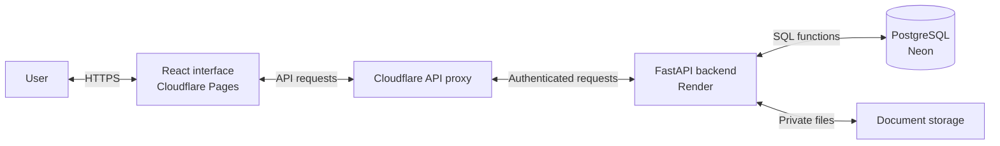

The frontend displays information and collects input. FastAPI authenticates users and calls approved database functions. PostgreSQL applies admission rules and stores the results. Uploaded documents are held in private storage, with their metadata recorded in the database.

Figure 2 follows one request, a student saving ranked choices, through every layer. Each layer performs its own check, so a mistake in one layer is caught by the next.

**Figure 2. One request through the system**

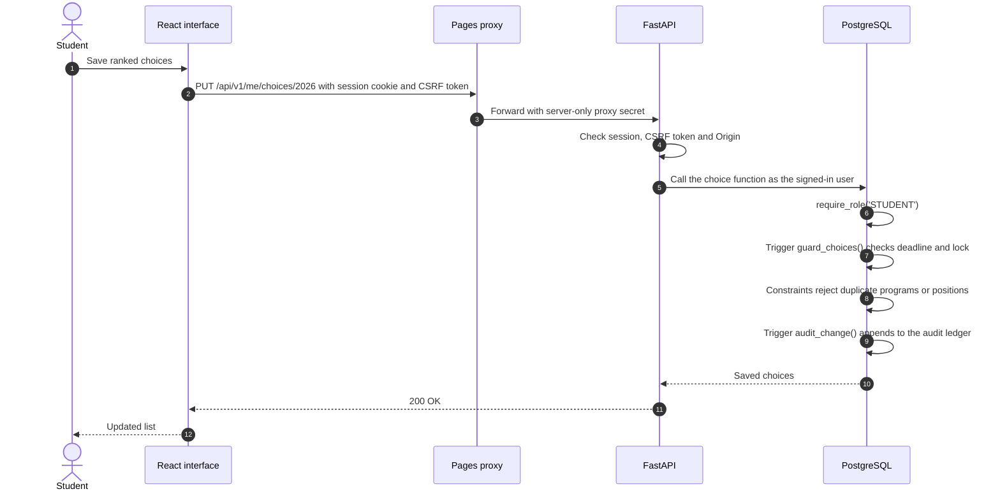

## 4. User Roles and Features

| Role | Main features |
|---|---|
| Student | Submit an application, upload documents, rank programs, view chances and allocations, and respond to results |
| Administrator | Review applications, manage exam results and seat capacity, configure rounds, publish allocations, and confirm admissions |
| Analyst | Explore saved simulations and compare changes in capacity or student participation |
| Auditor | Inspect audit events and historical seat-capacity records |

Additional features include CSV imports, mock allotments, historical cutoff information, an administrator Overview dashboard, and spot-seat availability.

**Screen 1. Student: ranked program choices**

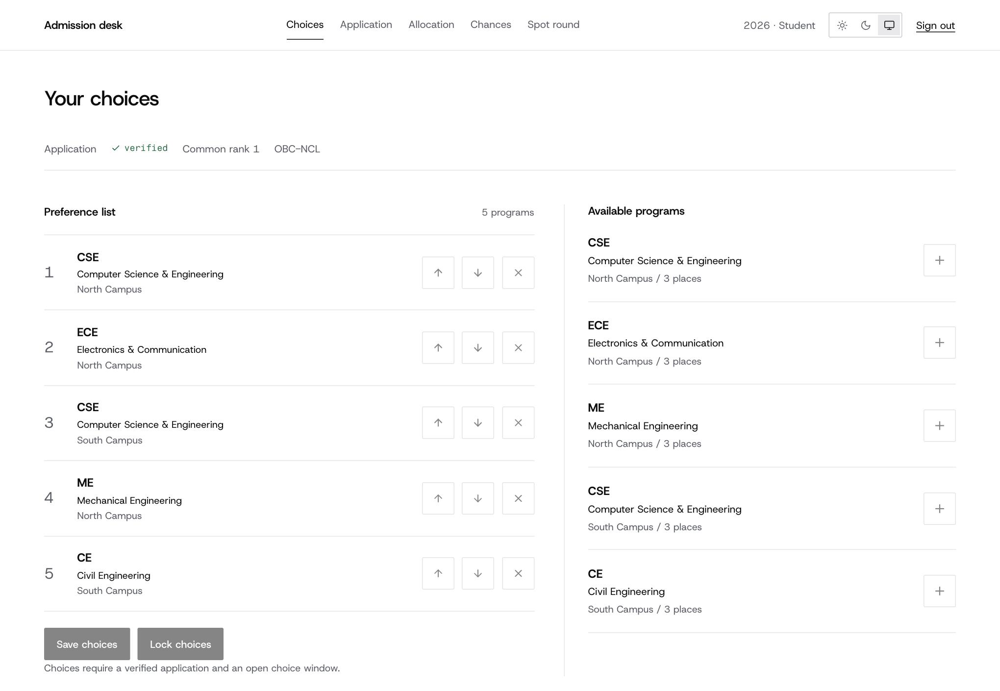

## 5. Database Design

The `admission` schema contains 31 tables. The database separates permanent student information from records that change each admission year. This allows one student to have applications and examination results for different cycles without duplicating their identity record.

| Main tables | Information stored |
|---|---|
| `student`, `app_user` | Student identity and user accounts |
| `admission_cycle`, `application`, `exam_result` | Annual admission settings, applications, marks, and ranks |
| `program`, `seat_matrix`, `choice` | Programs, category-wise capacity, and ranked preferences |
| `counselling_round`, `allocation`, `student_response` | Rounds, published seats, and student decisions |
| `seat_holding`, `final_admission` | Current holdings and confirmed admissions |
| `document_submission` | Document metadata and review status |
| `sim_input_snapshot`, `sim_run`, `sim_result` | Saved simulation inputs and outcomes |
| `spot_pool`, `spot_acceptance` | Available spot seats and acceptance records |
| `audit_ledger`, `seat_matrix_history` | Event history and changes in capacity |

**Figure 3. Core database relationships**

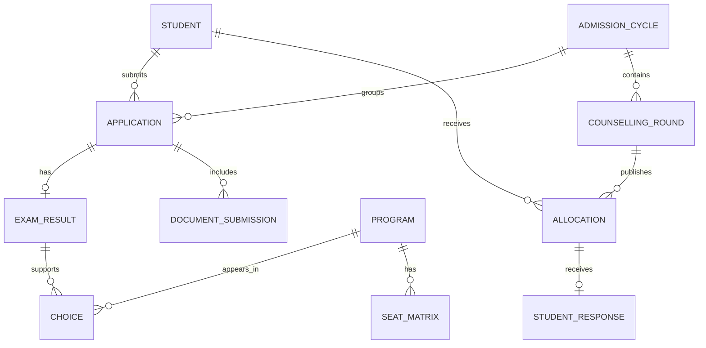

One student can apply in multiple years. Each application can have several documents and preferences. The diagram shows the main relationships; supporting tables are omitted for clarity. The complete diagram, with every column and key, is generated from the live schema in [docs/er-diagram.md](docs/er-diagram.md).

### 5.1 Keys and constraints

Primary keys identify records, while foreign keys connect related tables. Composite keys represent annual records and seat pools. UNIQUE constraints prevent duplicate preferences and conflicting holdings; CHECK constraints restrict marks, capacity, and valid statuses. The rules are declared in the schema, so no application bug can store a row that breaks them:

```sql
-- choice: one row per preference position, and a program can appear only once per list.
PRIMARY KEY (student_id, year, pref_order)
UNIQUE      (student_id, year, program_id)

-- seat_holding: the key itself means "at most one seat per student per year".
PRIMARY KEY (year, student_id)

-- spot_pool: remaining seats can never go below zero or above the starting capacity.
CHECK (seats_left >= 0 AND seats_left <= initial_capacity)

-- seat_matrix_history: two capacity records for the same pool cannot overlap in time.
EXCLUDE USING gist (year WITH =, program_id WITH =, seat_category WITH =, valid WITH &&)
```

### 5.2 Normalization

The core tables are in BCNF: in every table, each functional dependency has a candidate key on its left side.

| Table | Candidate keys | Functional dependencies |
|---|---|---|
| `student` | `student_id` | `student_id → full_name, dob` |
| `application` | `(student_id, year)` | `(student_id, year) → admission_category, status, review_reason` |
| `exam_result` | `(student_id, year)`; `(year, crl_rank)` | `(student_id, year) → total_marks, crl_rank, cat_rank` |
| `program` | `program_id`; `(institute, code)` | `program_id → institute, code, name` |
| `seat_matrix` | `(year, program_id, seat_category)` | `(year, program_id, seat_category) → seats` |
| `choice` | `(student_id, year, pref_order)`; `(student_id, year, program_id)` | Each key determines the other column |

Three design decisions follow from these dependencies:

- **No repeating groups (1NF).** A student's preferences are rows of `choice`, not a list in one column.
- **No partial dependencies (2NF).** A program's name depends only on `program_id`, so it lives in `program` and is never repeated on `choice`.
- **Annual facts are separate from identity (3NF/BCNF).** Category and rank belong to `(student_id, year)`; the student's name belongs to `student_id` alone.

Some data is repeated on purpose. A published `allocation` keeps the rank and preference that won the seat, so a later rank correction cannot rewrite history. Simulation snapshots keep a hashed JSON copy of their inputs so any run can be replayed exactly. Every such case, with the rule that keeps it correct, is listed in [docs/normalization.md](docs/normalization.md).

## 6. Admission and Allocation Workflow

**Figure 4. Admission process**

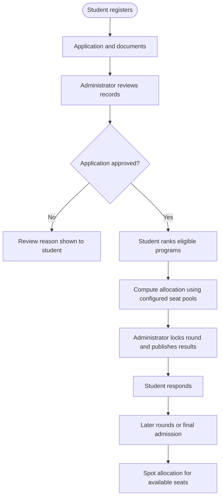

Two records carry this process: the application and the counselling round. Each has a `status` column restricted by a CHECK constraint, and only stored functions move it from one state to the next.

**Figure 5. Application status**

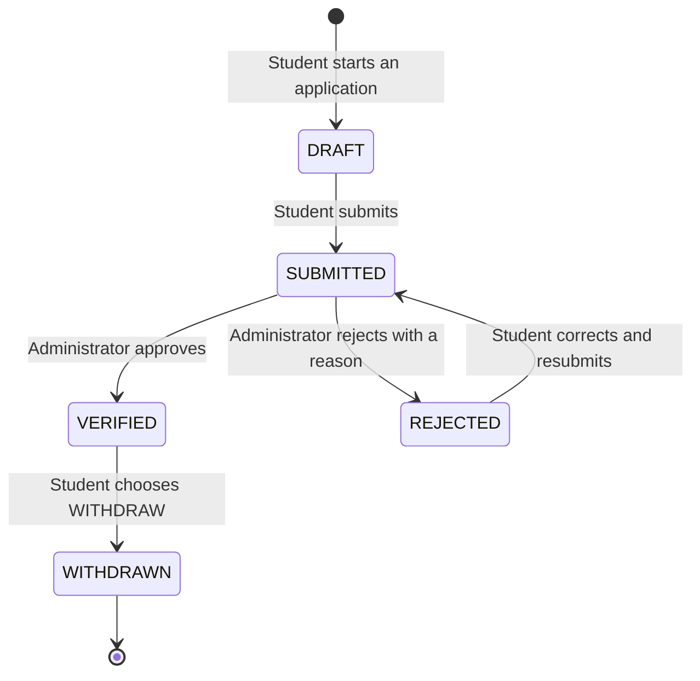

Approval requires a verified document. Only VERIFIED applications take part in allocation.

**Figure 6. Counselling round lifecycle**

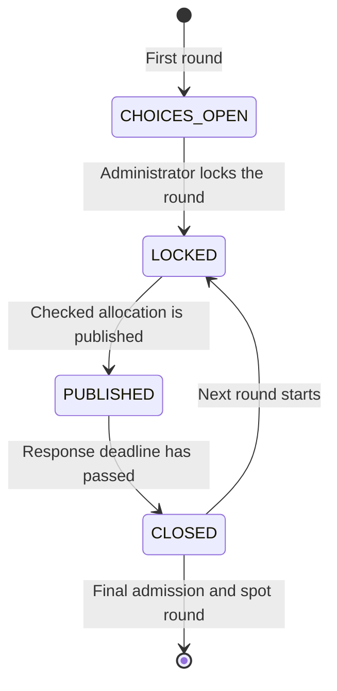

Publication is refused unless the round is LOCKED and the live inputs are unchanged since the run was computed. When a round closes, students who did not respond are recorded as FREEZE.

### 6.1 Seat allocation

The allocation engine uses deferred acceptance: applicants propose to eligible options in preference order, and each seat pool retains its highest-priority applicants within capacity. OPEN seats use common rank, while reserved pools (EWS, OBC-NCL, SC, ST) use category rank. The algorithm is written as set-based SQL inside the stored function `run_allocation()`.

**Figure 7. Seat allocation logic**

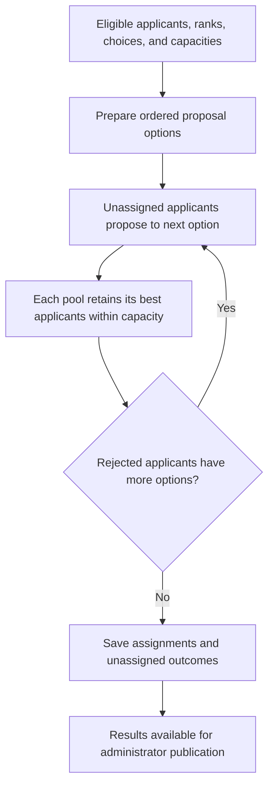

Before a result can be published, the database verifies it: no pool exceeds its capacity, and the result is stable, meaning no applicant is left out of a program they prefer while someone with a worse rank holds a seat there. Each run also stores an explanation for every applicant, which is what lets the interface answer "why did I not get this program?".

**Screen 2. Administrator Overview: the published seat plan**

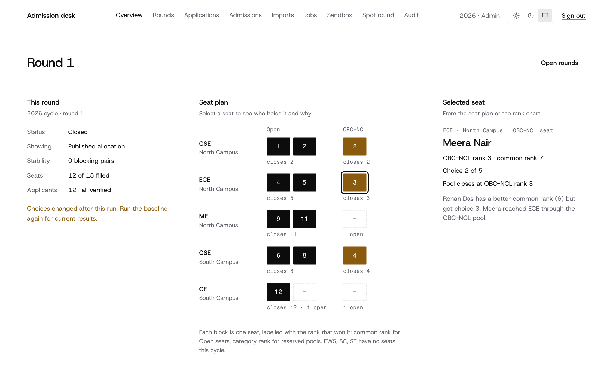

Each block is one seat, labelled with the rank that won it. Selecting a seat shows who holds it and why. In this example a student with common rank 7 received a better choice than a student with common rank 6, because she qualified through the OBC-NCL pool; the result reports 0 blocking pairs.

| Student decision | Meaning |
|---|---|
| FREEZE | Keep the assigned seat |
| FLOAT | Seek a more preferred program in a later round |
| SLIDE | Seek a more preferred program within the same institute |
| WITHDRAW | Leave the admission process |

**Screen 3. Student: allocation result, response, and explanation**

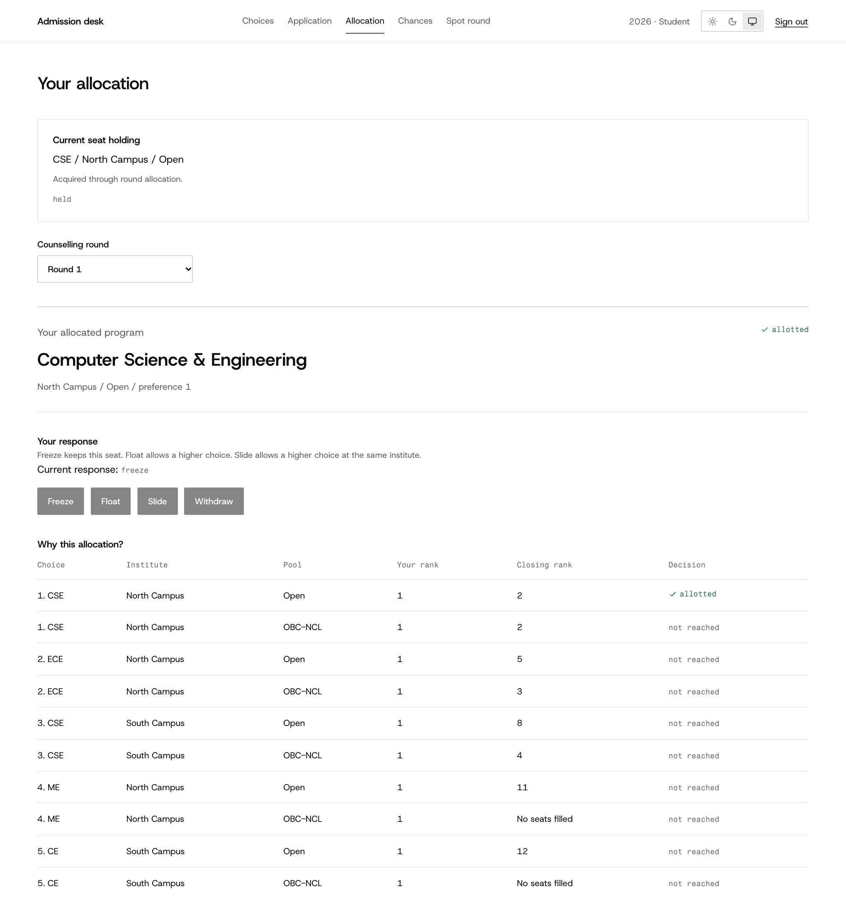

## 7. DBMS Concepts Demonstrated

| Concept | Where it is used in the project |
|---|---|
| Composite keys | Annual applications, choices, and seat pools |
| Referential integrity | Documents reference an application; a final admission references a seat holding |
| CHECK and exclusion constraints | Valid marks and statuses, non-negative capacity, non-overlapping history ranges |
| Stored functions | Allocation, publication, spot acceptance, and dashboard queries |
| Triggers | `guard_choices` (BEFORE), `audit_change` and `history_change` (AFTER) |
| Joins and aggregation | Applicant summaries, pool demand, and the admin Overview |
| Window functions | Deterministic ranking of imported examination results |
| Recursive CTE | Walking the audit hash chain and vacancy links |
| Views and materialized views | Published allocation trace; cutoff trends for the predictor |
| Transactions and locking | Publication, spot acceptance, scheduled jobs |
| Access control and row-level security | A runtime role limited to EXECUTE; policies on nine student-data tables |
| Temporal data | Seat-capacity history stored as time ranges |

A window function ranks students inside each category without collapsing the rows:

```sql
SELECT s.full_name, a.admission_category, e.crl_rank,
       rank() OVER (PARTITION BY a.admission_category ORDER BY e.crl_rank) AS rank_in_category
FROM application a
JOIN exam_result e USING (student_id, year)
JOIN student s USING (student_id)
WHERE a.year = 2026;
```

Each concept has a commented, runnable SQL file in [database/showcase](database/showcase/README.md). The runnable files roll back at the end, so they can be executed during the demonstration without changing the data.

## 8. Transactions and Concurrency Control

Transactions keep related updates together: publishing a round writes the allocation rows, the seat holdings, the round status, and an audit event, and either all of them commit or none do. Request identifiers (idempotency keys) mean a retried or double-clicked request returns the first answer instead of running twice.

The clearest case is the spot round, where many students may press Accept on the last seat at the same moment. A program that reads `seats_left`, checks it, and then writes the new value has a gap between the read and the write, and every request that reads during that gap sees a free seat. The project closes the gap by doing the read, the check, and the decrement in one statement:

```sql
UPDATE admission.spot_pool
SET    seats_left = seats_left - 1
WHERE  pool_id = p_pool AND status = 'OPEN' AND seats_left > 0;

IF NOT FOUND THEN
  RETURN jsonb_build_object('status', 'SEAT_UNAVAILABLE');
END IF;
```

**Figure 8. Two students, one remaining seat**

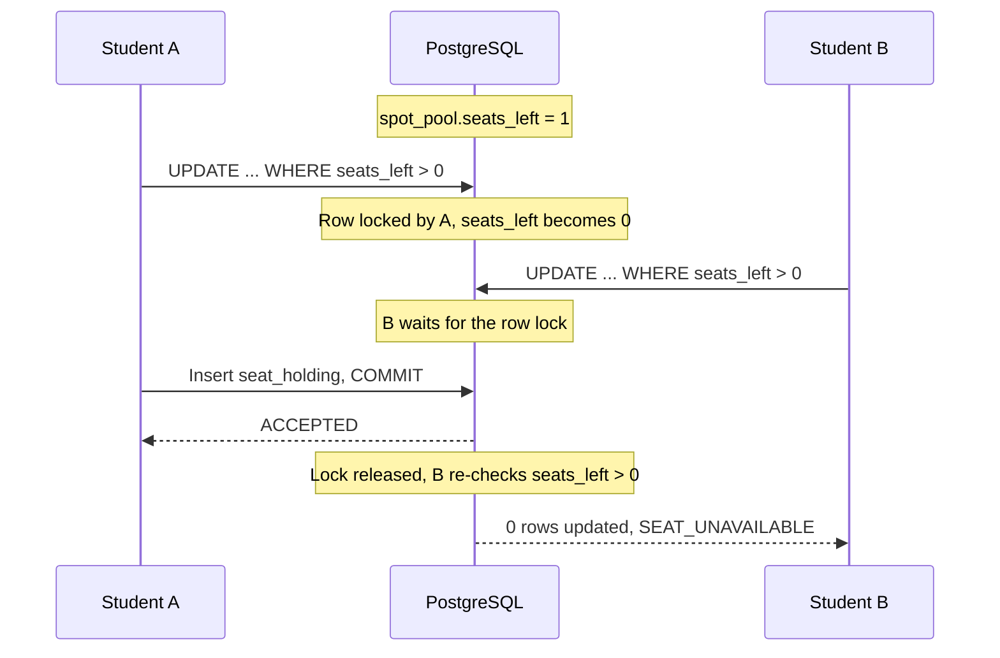

| Approach | Requests for one seat | Accepted | Result |
|---|---|---|---|
| Unsafe read-then-write (disposable test table) | 50 at once | 50 | Overbooked by 49 |
| Project's atomic update | 500 through 50 clients | 1 | Correct; 499 refused, 0 errors |

The command `npm run demo:race` repeats this comparison live in a throwaway database.

## 9. Security and Audit

Passwords are protected using Argon2 hashing. Sessions, CSRF protection, and role checks control access to the API. Documents remain private and are retrieved through authorized requests.

Access control is also enforced inside the database. The API connects as a role that has no privileges on any table; it can only execute an approved list of functions. Each function begins with `require_role(...)` and raises an error for the wrong role, so even a faulty API route cannot read or change tables directly. Row-level security policies on nine student-data tables are a second layer for any role that is given table access.

Every change to the ten main admission tables (applications, choices, results, documents, seat capacity, rounds, allocations, responses, holdings, and spot acceptances) is recorded by a trigger in an audit ledger. Each event stores the hash of the event before it, which makes tampering detectable: editing an old event changes its hash and breaks every link after it.

**Figure 9. Hash-chained audit ledger**

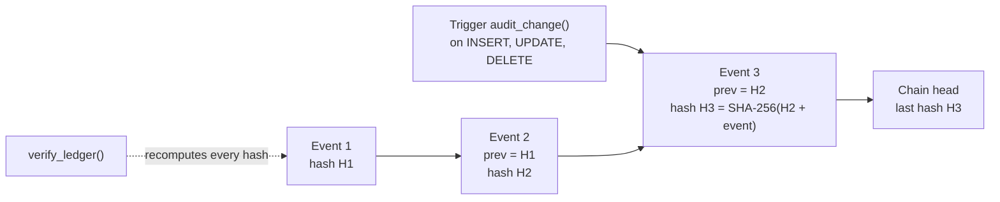

The auditor can verify the whole chain from the interface and compare it against a checkpoint saved earlier. The same trigger mechanism keeps a time-ranged history of seat capacity, so the system can answer what a pool's capacity was at any past moment.

**Screen 4. Auditor: ledger verification**

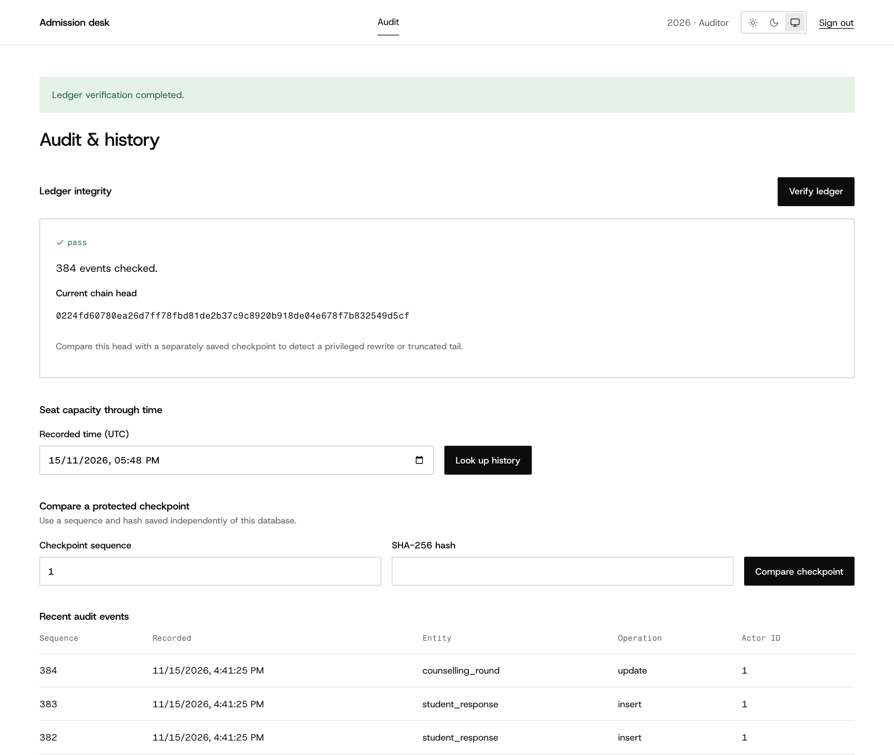

## 10. Testing and Results

| Check | Recorded result |
|---|---|
| Database and API tests | 40 passed on PostgreSQL 16; the baseline also passed on PostgreSQL 18 |
| Frontend request tests | 6 passed |
| Browser workflows (Playwright) | 6 passed |
| Concurrent spot acceptance | 500 requests for 1 seat: 1 accepted, 0 overbooked |
| Randomized allocation checks | 100 scenarios of 300 students: 0 violations |
| Backup and restore | Table hashes, document hashes, audit chain, and privileges matched |
| Large dataset (20,000 students, 240,000 choices) | All correctness checks passed; median run time 38.3 seconds |

The large-dataset run met its correctness checks but not the original five-second target. The raw measurements and query plans are kept in the [evidence](evidence/local-verification.md) folder.

## 11. Limitations and Future Scope

| Limitation | Possible improvement |
|---|---|
| Allocation of 20,000 students takes about 38 seconds | Profile and optimize the solver and its verification step |
| Fixed OPEN, EWS, OBC-NCL, SC, and ST pools only | Add horizontal reservations, supernumerary seats, and category conversion |
| Chance bands are based on synthetic history | Evaluate against real historical cutoffs |
| Free hosting can sleep and delay scheduled jobs | Use dedicated compute and add alerts |
| An owner with full database access could rewrite the audit chain | Keep checkpoints in independent storage |

## 12. Conclusion

The College Admission Management System combines a web interface with database-enforced admission rules. It organizes applications, preferences, counselling decisions, and seat assignments while demonstrating relational modeling, normalization, integrity constraints, triggers, transactions, concurrency control, and access control. Its tests show that the allocation is correct and that concurrent requests cannot overbook a seat. The project provides a practical foundation for an admission platform within its implemented fixed-pool policy.

**Application:** [college-admission-164.pages.dev](https://college-admission-164.pages.dev/)

**Further reading:** [full ER diagram](docs/er-diagram.md), [normalization](docs/normalization.md), [data dictionary](docs/data-dictionary.md), [DBMS showcase](database/showcase/README.md)
