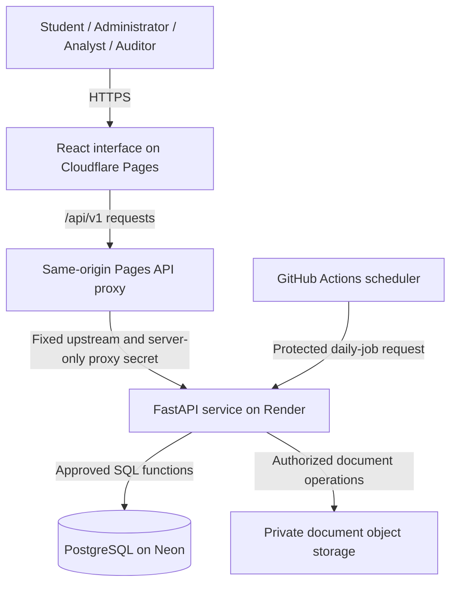
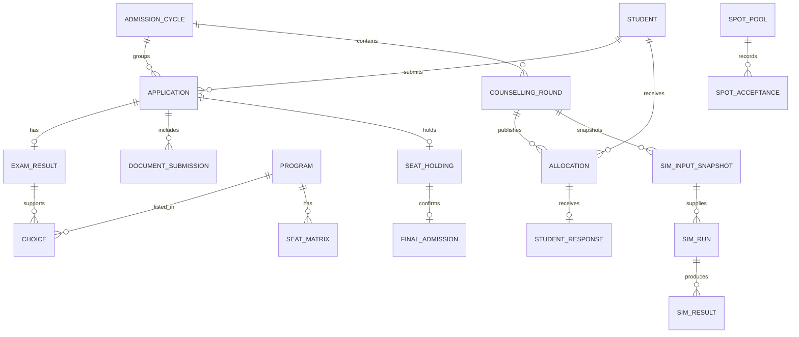

# College Admission Management System

## Project Report

| Item | Details |
|---|---|
| Project area | Database Management Systems and web application development |
| Frontend | React, TypeScript, Vite |
| Backend | Python, FastAPI, Uvicorn |
| Database | PostgreSQL on Neon |
| Deployment | Cloudflare Pages frontend and API proxy; Render backend; Neon database and private object storage |
| Application | [College Admission Management System](https://college-admission-164.pages.dev/) |

---

## Abstract

The College Admission Management System is a database-centered web application for managing an annual admission cycle. It supports student applications, document verification, examination records, ranked program preferences, seat allocation, counselling rounds, applicant decisions, final admission, and spot allocation. Four roles—student, administrator, analyst, and auditor—receive separate interfaces and permissions.

The project places admission rules and consistency controls in PostgreSQL. The React interface presents the workbench, while FastAPI authenticates requests, validates submitted information, manages private documents, and calls approved database functions. PostgreSQL executes the allocation algorithm, validates results, protects seat capacity, records audit events, and preserves historical and simulation data.

The application also provides historical chance bands, scheduled mock allotments, immutable what-if simulations, and an administrator Overview page. Its deployed architecture uses Cloudflare Pages, Render, and Neon. Testing evidence demonstrates functional correctness, concurrency control, and recovery behavior. The report also records an important limitation: the measured allocation time for the large synthetic dataset exceeds the original five-second target.

## 1. Introduction

College admission involves more than collecting student forms. An institution must combine eligibility, ranks, preferences, category-specific capacity, document status, and counselling decisions while keeping records consistent. Multiple users may work at the same time, and administrators must be able to explain why an applicant received a particular seat.

This project models these requirements as a relational database application. The database serves as the authority for admission state and allocation rules. The web interface makes the workflows accessible to different users, and the API provides a controlled boundary between those users and the database.

The system uses synthetic admission records for demonstration. It is an academic implementation of a fixed-pool policy rather than a certified implementation of any national admission scheme.

## 2. Problem Statement

Admission processes managed through disconnected spreadsheets or manual records can suffer from duplicate entries, inconsistent ranks, outdated seat counts, and incomplete histories. Concurrent requests can allocate the same available seat more than once if capacity is checked and updated separately. Changes to applicant information can also make an earlier allocation difficult to reproduce.

The project addresses these problems by maintaining one authoritative database, enforcing integrity through constraints and guarded functions, executing allocation inside transactions, preserving immutable simulation inputs, and recording important operations in an auditable history.

## 3. Objectives

The main objectives are to:

1. Maintain annual applications, examination results, documents, programs, and seat pools in a relational database.
2. Provide authenticated interfaces for students, administrators, analysts, and auditors.
3. Allocate seats using verified ranks and ordered preferences without exceeding capacity.
4. Support multiple counselling rounds and FREEZE, FLOAT, SLIDE, and WITHDRAW decisions.
5. Explain allocation outcomes and preserve the inputs used to produce them.
6. Allow analysts to compare hypothetical scenarios without changing live capacity or holdings.
7. Prevent duplicate or conflicting operations through transactions, locks, constraints, and idempotency.
8. Demonstrate normalization, stored functions, triggers, views, indexing, concurrency control, and recovery.
9. Deploy the application and verify the integration between the frontend, backend, and database.

## 4. Scope

### 4.1 Included functionality

The implemented scope covers account authentication, student registration, annual applications, private document upload and review, examination records, CSV imports, ranked choices, eligibility checks, allocation simulations, publication, later counselling rounds, final admissions, and spot seats.

Supporting functionality includes historical cutoff imports, prediction freshness indicators, mock allotments, scheduled jobs, audit verification, checkpoint comparison, temporal seat history, masked simulation exports, and backup/restore verification tools.

### 4.2 Scope boundaries

The admission model uses fixed OPEN, EWS, OBC-NCL, SC, and ST pools. Horizontal reservations, supernumerary seats, and category conversion are outside the implemented policy. Historical chance bands use synthetic data and are heuristics rather than calibrated probabilities. Vacancy links describe possible propagation between seat pools rather than uniquely established causal chains.

## 5. User Roles

| Role | Main responsibilities | Interface sections |
|---|---|---|
| Student | Maintain an application, upload documents, rank programs, inspect forecasts and allocations, respond to results, and view spot availability | Choices, Application, Allocation, Chances, Spot round |
| Administrator | Review records, manage ranks and capacity, configure rounds, publish allocations, monitor jobs, and confirm admissions | Overview, Rounds, Applications, Admissions, Imports, Jobs, Sandbox, Spot round, Audit |
| Analyst | Inspect saved runs and compare capacity or withdrawal scenarios using immutable inputs | Sandbox |
| Auditor | Inspect event metadata, verify the audit chain, compare checkpoints, and retrieve historical seat capacity | Audit |

The interface exposes role-appropriate navigation. Authorization is also enforced behind the interface by API identity checks and database routines.

## 6. Technology Stack

| Layer | Technology | Purpose |
|---|---|---|
| User interface | React 19 and TypeScript | Component-based interfaces with typed API data |
| Frontend tooling | Vite and TypeScript compiler | Development server, compilation, and production assets |
| Styling | CSS and bundled fonts | Responsive layouts and light/dark themes |
| API | FastAPI and Pydantic | HTTP routing and input validation |
| Application server | Uvicorn | Runs the Python ASGI application |
| Database access | Psycopg 3 and Psycopg connection pool | Parameterized PostgreSQL calls and bounded connections |
| Password protection | Argon2 through `argon2-cffi` | Password hashing and verification |
| Database | PostgreSQL | Relational storage, allocation functions, constraints, transactions, and audit |
| Object storage integration | Local adapter or private S3-compatible storage; Boto3 | Store and retrieve document bytes |
| Testing | Pytest, HTTPX, Vitest, Playwright, and Node test runner | Database/API, frontend, browser, and proxy checks |
| Hosting | Cloudflare Pages, Render, and Neon | Frontend/proxy, backend, and database/storage |
| Automation | GitHub Actions | Repository verification and scheduled job requests |

The deployment configuration specifies Python 3.12.14. The live database reported PostgreSQL 16.16 during the November 2026 inspection. These deployment versions are distinct from the versions used in older local benchmark evidence.

## 7. System Architecture



### 7.1 Frontend

React renders forms, tables, allocation views, simulation details, and audit controls. The API client uses the same-origin `/api/v1` path by default. For modifying requests, it includes the CSRF token supplied through the application's cookie mechanism.

### 7.2 API and proxy

The Pages proxy forwards `/api/*` requests to a fixed HTTPS backend origin and attaches a server-only proxy secret. This arrangement keeps authentication cookies on the frontend domain. FastAPI handles authentication, request validation, file processing, and calls into PostgreSQL.

### 7.3 Database

PostgreSQL stores the authoritative admission records and executes business rules through versioned SQL functions. The runtime role is separate from the owner role and accesses approved functions rather than application tables directly. The connection pool has a maximum of eight connections.

### 7.4 Documents

Document metadata belongs in PostgreSQL; file bytes belong in private object storage. Downloads pass through an authorized API endpoint. The storage adapter allows local development to use local files while the hosted application uses private S3-compatible storage.

## 8. Functional Modules

### 8.1 Authentication and sessions

Users sign in with an email address and password. Passwords are stored as Argon2 hashes. Successful authentication creates opaque session and CSRF values; their digests are stored in PostgreSQL. Production uses Secure cookies and disables the development-account listing endpoint. Login-attempt limits are persisted in the database.

### 8.2 Applications, documents, and examination records

A student has an identity record and can have an application for each admission year. Documents follow a pending/verified/rejected review process. Uploads accept PDF, PNG, or JPEG content up to 5 MB and validate file signatures rather than trusting the filename alone.

Administrators verify documents and examination information before approving an application. Examination results can be entered manually or imported through CSV. The subject-mark import computes deterministic ranks using total marks, mathematics, physics, earlier birth date, and student ID as tie-break criteria. Import preview and commit are separate, and a source revision check rejects stale previews.

### 8.3 Program choices

Students maintain an ordered list of eligible programs. Constraints prevent duplicate programs and repeated preference positions for the same student and year. A list contains at most 30 preferences. Database guards enforce verification requirements, deadlines, and locked-choice state.

### 8.4 Allocation and counselling

Administrators configure capacity and counselling deadlines, inspect a baseline run, lock the round, and publish a checked allocation. Published outcomes become the basis for student decisions and later rounds. Final admission confirmation is available after the required round closure conditions are satisfied.

### 8.5 Simulations and analysis

Saved simulation inputs allow analysts to replay a baseline and evaluate changes such as increased capacity or withdrawals. Results include assignments, closing ranks, differences, verification checks, and possible vacancy links. Analysts see masked student identifiers in analysis output. Saved runs can be pinned for retention and exported as CSV.

### 8.6 Historical chances and mock allotments

The predictor uses historical cutoff information and displays chance bands with freshness information. Target-year outcomes are excluded from that year's historical prediction. Mock allotments show an outcome against a saved input revision without creating live seat holdings.

### 8.7 Administrator Overview

The Overview page combines the current round, applicant counts, seat plan, demand, application funnel, run timings, and recent activity. Its data is supplied by the read-only `admission.admin_overview(year)` function. It displays the current round's published allocation or latest eligible live baseline. If neither exists, the page displays an explicit empty allocation state.

### 8.8 Audit and operations

Audit tools verify the hash chain, page through event metadata, compare a separately retained checkpoint, and retrieve historical seat capacity. Operations tools display scheduled job status and prediction freshness. Durable job records support retries and duplicate-slot protection.

## 9. Database Design

The migrated `admission` schema contains **31 base tables**. Supporting objects include stored functions, indexes, a materialized cutoff view, the allocation trace view, triggers, and row-level security policies. Migration history is recorded separately in `public.schema_migration`.

### 9.1 Principal relations

| Relation | Main key | Responsibility |
|---|---|---|
| `student` | `student_id` | Student identity and birth date |
| `app_user` | `user_id`; unique email | Login identity, role, enabled state, and optional student link |
| `app_session` | `token_hash` | Session identity, CSRF digest, and expiry |
| `admission_cycle` | `year` | Annual deadlines, lock state, policy, and input revision |
| `application` | `(student_id, year)` | Annual application category and review state |
| `exam_result` | `(student_id, year)` | Annual marks, common rank, and category rank |
| `program` | `program_id`; unique `(institute, code)` | Institute-specific program identity |
| `program_eligibility` | `(year, program_id)` | Minimum marks by program and year |
| `seat_matrix` | `(year, program_id, seat_category)` | Annual capacity per pool |
| `choice` | `(student_id, year, pref_order)` | Ranked program preferences |
| `counselling_round` | `round_id`; unique `(year, round_no)` | Round lifecycle and publication reference |
| `allocation` | `(round_id, student_id)` | Published round results |
| `student_response` | `(round_id, student_id)` | Response to a published allocation |
| `seat_holding` | `(year, student_id)` | Current annual holding |
| `final_admission` | `(year, student_id)` | Final admission confirmation |
| `document_submission` | `document_id`; unique storage key | Private file metadata, checksum, size, and review |
| `sim_input_snapshot` | `snapshot_id` | Immutable input payload and hash |
| `sim_run` | `sim_id` | Run metadata, checks, summary, and baseline reference |
| `sim_result`, `sim_student_outcome`, `sim_trace`, `sim_diff` | Composite keys including `sim_id` | Assignments, outcomes, explanations, and comparisons |
| `hist_closing` | `(year, round_no, program_id, seat_category)` | Historical cutoff information |
| `spot_pool` | `pool_id`; unique annual program/pool | Remaining spot capacity |
| `spot_acceptance` | `acceptance_id` | Idempotent spot acceptance records |
| `audit_ledger`, `audit_chain_head` | Sequence and singleton keys | Audit events and protected chain head |
| `seat_matrix_history` | `history_id` | System-time capacity history |
| `prediction_state`, `job_run`, `login_attempt` | Annual, job, and attempt keys | Predictor freshness, job execution, and login throttling |

### 9.2 Main relationships



This is a conceptual summary. The complete schema diagram and constraint definitions are available in [the ER documentation](docs/er-diagram.md) and [data dictionary](docs/data-dictionary.md).

### 9.3 Integrity constraints

Primary keys identify records, foreign keys preserve valid references, UNIQUE constraints prevent duplicate choices and holdings, and CHECK constraints restrict marks, capacity, statuses, and decisions. For example:

```sql
-- Annual seat pools have one capacity record each.
PRIMARY KEY (year, program_id, seat_category)

-- A program can appear only once in a student's annual list.
UNIQUE (student_id, year, program_id)

-- Remaining capacity cannot be negative or exceed its starting value.
CHECK (seats_left >= 0 AND seats_left <= initial_capacity)
```

An exclusion constraint prevents overlapping validity ranges for the same historical seat pool. Migration `0020` adds an identity primary key to `login_attempt`, completing primary-key coverage across all application tables.

## 10. Normalization

The core relational tables are designed around dependencies on their candidate keys. Annual facts are separated from permanent identities: a student's name belongs to identity data, while the student's admission category and examination result belong to a specific year.

| Relation | Example dependency | Design consequence |
|---|---|---|
| `program` | `program_id → institute, code, name` | Choices reference a program instead of repeating its descriptive fields |
| `application` | `(student_id, year) → category, status, review_reason` | Application state is stored per admission cycle |
| `seat_matrix` | `(year, program_id, seat_category) → seats` | Capacity is an annual pool fact |
| `choice` | `(student_id, year, pref_order) → program_id` | Preference order is represented by rows |
| `choice` | `(student_id, year, program_id) → pref_order` | A second candidate key prevents duplicate program choices |

The core relations are documented as BCNF under the stated dependencies, with explicit redundancy qualifications. The design also deliberately stores derived or repeated information:

- `full_name` appears in both `student` and `app_user`; a shared person relation could remove this duplication.
- `total_marks` can be derived from subject marks, but manual rank entry may supply only a total. A CHECK enforces equality when all subject marks exist.
- Published allocations retain the rank and preference used at publication so later corrections do not rewrite their meaning.
- `spot_acceptance.year` supports a declarative uniqueness rule for one annual spot acceptance, although the year is also reachable through the pool.
- JSONB snapshots and simulation outputs preserve historical inputs and results rather than depending on mutable live records.

The normalization claims therefore apply to the core relational model rather than to every cache, snapshot, or derived structure. [Normalization documentation](docs/normalization.md) records the detailed dependencies and tradeoffs.

## 11. Seat Allocation Algorithm

### 11.1 Inputs and priorities

The allocation engine combines verified applicants, eligibility, ranked choices, annual pool capacities, and applicable prior-round decisions. Each ranked program expands into eligible OPEN and category-pool proposals while retaining the student's original program preference.

OPEN pools use common rank. Reserved pools use verified category rank. The supported category values are `OPEN`, `EWS`, `OBC_NCL`, `SC`, and `ST`.

### 11.2 Deferred acceptance

The solver uses deferred acceptance implemented in PostgreSQL:

1. Capture or load the immutable input snapshot and validate its hash.
2. Prepare eligible proposal options and prior-round restrictions.
3. Have unassigned applicants propose to their next permissible option.
4. Retain the best eligible applicants at each pool up to its capacity.
5. Reject excess proposals so those applicants can try their next option.
6. Repeat until no further proposals can be made.
7. Persist assignments, unassigned outcomes, traces, differences, and checks.

The latest solver definition is in migration `0015_allocation_phase_timings.sql`. Earlier definitions remain in migration history; they do not represent additional active solvers.

### 11.3 Correctness checks

Runs check pool capacity and blocking-pair stability. Later-round processing protects applicable previous holdings and checks for prohibited downgrades. Add-only scenarios test monotonicity only when the other saved inputs are identical. These checks apply to the implemented priority and eligibility model.

### 11.4 Publication and decisions

Publication requires an authorized administrator, a locked round, unchanged live inputs, and an idempotency key. Results, current holdings, relevant state transitions, and audit changes commit transactionally.

| Decision | Meaning |
|---|---|
| FREEZE | Retain the allocated seat without seeking an improvement |
| FLOAT | Allow a more preferred eligible program while preserving the required fallback |
| SLIDE | Allow a more preferred program within the same institute |
| WITHDRAW | Leave participation and release the applicable holding |

## 12. Transactions and Concurrency Control

### 12.1 ACID behavior

Atomic transactions keep related admission updates together. Constraints and validation preserve consistency. Allocation calls use repeatable-read transactions where required, and the application retries bounded serialization/deadlock failures. Committed PostgreSQL records provide durable state; recovery tools also account for committed document objects.

### 12.2 Seat safety and idempotency

Spot acceptance uses guarded capacity updates and locking so competing requests cannot all accept the same remaining place. Uniqueness rules protect annual student holdings and request identifiers. Publication keys prevent a retried request from publishing duplicate results.

Jobs use locks and unique schedule slots to avoid overlapping or duplicate execution. The database also serializes audit-chain updates, which preserves chain order but can become a contention point under concurrent workloads.

## 13. SQL and DBMS Concepts Demonstrated

| Concept | Project example |
|---|---|
| Composite keys | Annual applications, choices, and seat matrices |
| Referential integrity | Documents reference annual applications; final admissions reference holdings |
| CHECK and exclusion constraints | Valid marks, nonnegative capacity, and nonoverlapping historical ranges |
| Stored functions | Allocation, publication, workspace retrieval, and Overview aggregation |
| Triggers | Choice guards, audit recording, and seat-capacity history |
| Joins and aggregation | Applicant summaries, pool demand, and admin dashboards |
| Conditional aggregation | Application funnel using aggregate `FILTER` clauses |
| Window functions | Deterministic ranking in examination imports |
| Recursive CTEs | Possible vacancy-link analysis |
| Views and materialized views | Published allocation traces and cutoff trends |
| Indexes | Keys and frequently queried relationships, sessions, and login attempts |
| Transactions and locking | Publication, spot acceptance, jobs, and audit-chain serialization |
| Access control and RLS | Restricted runtime privileges and student-data policies |
| Temporal data | `tstzrange` seat-capacity history |
| JSONB and hashes | Immutable solver inputs and audit envelopes |

Readable examples are provided in [database/showcase](database/showcase/README.md).

## 14. Security Design

The security model combines password hashing, expiring sessions, CSRF validation, exact Origin validation for modifying requests, and role checks. Session values and CSRF values are stored as digests. Production cookies are Secure and use SameSite protection; the session cookie is HttpOnly.

The runtime database account has no direct application-table privileges. Approved `SECURITY DEFINER` routines run with their owner's privileges, pin their search path, and validate the actor supplied by the trusted API. Row-level security policies exist on nine student-data tables as an additional layer for non-owner table access. Owner-executed functions bypass those policies by design, so routine authorization and restricted EXECUTE permissions remain central controls.

Private files require an authorized download request. File size, MIME signature, metadata checksum, and stored size support validation and integrity checks. Analysis output masks student identifiers for the analyst role. CSV generation also protects against spreadsheet formula interpretation in exported values.

The API's database credentials remain a trusted boundary: possession of arbitrary database access is not equivalent to a normal signed-in application session. Owner credentials are kept out of the hosted application runtime. Passwords, connection strings, tokens, and private credentials are intentionally excluded from this report.

## 15. Audit and Historical Records

The audit ledger stores complete event envelopes and predecessor hashes. Verification recalculates hashes and checks event sequence, links, and the stored chain head. A separately retained checkpoint allows comparison with a previously trusted chain state.

This produces tamper evidence, not absolute protection against an owner who can replace the database and every trusted checkpoint. Independent checkpoint retention is necessary to detect a complete privileged rewrite.

Seat-capacity history records system-time ranges. It can answer what capacity was recorded at a specified timestamp; it does not model separately editable business-effective dates.

## 16. API Design and Health Monitoring

The deployed OpenAPI schema inspected on 13 November 2026 exposed **47 HTTP operations**. Most application routes use `/api/v1`; scheduled processing uses a separate protected backend route.

| Area | Representative endpoints |
|---|---|
| Authentication | `POST /api/v1/auth/login`, `POST /api/v1/auth/logout`, `GET /api/v1/auth/me` |
| Registration | `POST /api/v1/auth/register` |
| Workspace | `GET /api/v1/workspace` |
| Student choices and results | `PUT /api/v1/me/choices/{year}`, `GET /api/v1/me/rounds/{round_id}/why-not` |
| Predictions and holdings | `GET /api/v1/me/predictor/{year}`, `GET /api/v1/me/holding/{year}` |
| Administrator dashboards | `GET /api/v1/admin/overview/{year}`, `GET /api/v1/admin/dashboard/{year}` |
| Round publication | `POST /api/v1/admin/rounds/{round_id}/publish` |
| Simulations | `POST /api/v1/simulations`, `GET /api/v1/simulations/{sim_id}` |
| Documents | `POST /api/v1/me/applications/{year}/documents`, `GET /api/v1/documents/{document_id}` |
| Audit | `GET /api/v1/audit/verify`, `GET /api/v1/audit/events`, `POST /api/v1/audit/checkpoint` |
| Spot availability | `GET /api/v1/spot/{year}` |
| Scheduling | `POST /internal/jobs/daily` on the Render backend |

### 16.1 Health endpoint

`GET /api/v1/health` reports that the API process is responding:

```json
{"status":"ok","service":"admission-api"}
```

### 16.2 Readiness endpoint

`GET /api/v1/ready` executes `SELECT 1` through the application's database connection and reports:

```json
{"status":"ready","database":"postgresql"}
```

Readiness therefore checks database connectivity as well as the HTTP service. It is not an exhaustive schema or workflow check: the Overview migration issue described below occurred while readiness could still succeed.

Live monitoring URLs:

- [Render health](https://college-admission-api-164.onrender.com/api/v1/health)
- [Render readiness](https://college-admission-api-164.onrender.com/api/v1/ready)
- [Readiness through the Pages proxy](https://college-admission-164.pages.dev/api/v1/ready)

## 17. Deployment and Operations

| Component | Deployment arrangement |
|---|---|
| Frontend | Cloudflare Pages at `college-admission-164.pages.dev` |
| API proxy | Repository-root Pages Functions handling `/api/*` |
| Backend | Render at `college-admission-api-164.onrender.com` |
| Database | Neon PostgreSQL, production branch `main`, AWS Singapore |
| Documents | Private `admission-documents` bucket |
| Scheduler | GitHub Actions requests the protected daily-job endpoint |

The frontend build command is `npm run build`, with output in `frontend/dist`. Render installs the Python backend and runs Uvicorn. Its configured health-check path is `/api/v1/ready`.

Deployment configuration supplies the database URL, frontend origin, storage settings, proxy secret, and scheduler credentials through server-side configuration. Database owner credentials are not part of the web runtime. The solver requires a direct Neon connection because it uses temporary tables and session state.

The scheduled workflow targets 02:00 India time. Free-tier scheduling can be delayed, and free compute can sleep. Durable job records allow status inspection and catch-up. Actual job completion times must be read from job history rather than assumed from the configured schedule.

## 18. Testing and Verification

### 18.1 Recorded local and CI evidence

The following results come from existing repository evidence. They are historical measurements, not newly rerun tests performed while writing this report.

| Check | Recorded result |
|---|---|
| Local database/API baseline | 38 passed on PostgreSQL 16.15 and 38 passed on PostgreSQL 18.4 |
| Later recorded Linux/CI database/API suite | 40 passed |
| Frontend request tests | 6 passed |
| Proxy tests in deployment evidence | 2 passed |
| Browser workflows | 6 passed |
| Production build | Passed |
| Restore including a committed synthetic document | Table/document hashes, ledger, migrations, and runtime privileges passed |
| Randomized add-only verification | 100 seeded scenarios of 300 students; zero violations |
| Concurrent spot allocation | 500 requests through 50 clients; one acceptance, 499 unavailable, zero failures |
| Concurrent analyst allocations | Three runs passed with bounded serialization retries |

The repository has evolved beyond the earlier baseline, so these counts describe their recorded runs rather than an assertion about today's complete test-suite size.

### 18.2 Hosted inspection on 13 November 2026

Browser inspection covered the nine administrator navigation sections, five student sections, analyst Sandbox, and auditor Audit section. Login and logout worked for all four roles. Saved simulation details, document metadata, job history, prediction displays, and audit tools were inspected.

API inspection inventoried 47 operations and confirmed that all 41 protected `/api/v1` operations rejected anonymous requests. Authenticated read checks covered workspaces, dashboards, forecasts, holdings, simulations, audit events, ledger verification, seat history, documents, and CSV export. Existing demo PDF downloads matched their stored SHA-256 checksums and byte counts. Checkpoint comparison returned a matching result.

For a round that had not been published, the explanation endpoint returned the expected HTTP 409 response. The student Allocation page correctly displayed the unpublished state rather than fabricated results.

The inspection did not execute production registration, uploads, publication, seat edits, allocation jobs, or other admission-changing workflows. Their historical automated evidence should not be confused with a fresh production end-to-end execution.

### 18.3 Schema mismatch and correction

The hosted frontend and backend included the new Overview feature, but production Neon initially contained only migrations `0001` through `0018`. The missing `admin_overview(year)` function caused `GET /api/v1/admin/overview/2026` to return HTTP 503.

The correction followed this sequence:

1. Create a temporary Neon child branch from production.
2. Apply existing migrations `0019_admin_overview.sql` and `0020_login_attempt_key.sql`.
3. Verify application record counts, login-attempt primary-key integrity, migration rerun behavior, and Overview execution through the runtime role.
4. Apply the validated migrations to production.
5. Verify the Overview API returns HTTP 200 and the browser renders the dashboard without console warnings or errors.
6. Recheck role-specific read APIs, audit integrity, login/logout, and readiness through both Render and Pages.
7. Remove the temporary test branch.

Production reached migration level 20. Checked application, choice, document, allocation, and user record counts were preserved. The repair required no source-code changes or application redeployment.

At verification time, the Overview showed 12 verified applicants and 15 seats, with no current published allocation or qualifying live baseline. This is an expected data state: scheduled mock runs do not become the live allocation displayed by Overview.

## 19. Performance Evaluation

The committed large synthetic fixture contains 20,000 students, 240,000 choices, 30 programs, and 150 seat pools.

| Measurement | Recorded result |
|---|---|
| Sequential allocation samples | 5 |
| Median allocation time | 38,306 ms, approximately 38.3 seconds |
| Nearest-rank p95 | 43,251 ms, approximately 43.3 seconds |
| Original target | 5 seconds |
| Target achieved | No |
| Correctness checks | Capacity, stability, and applicable monotonicity passed |
| Student workspace requests under allocation load | 922 samples |
| Workspace latency under that local load | Median 21.835 ms; maximum 254.81 ms |

Solver work and verification/persistence dominate the measured phases. Audit-chain serialization also introduces contention for concurrent operations. The p95 estimate uses only five sequential allocation samples and should be interpreted with that small sample size in mind.

These are local measurements. They do not establish the latency or throughput of the free hosted deployment.

## 20. Backup, Recovery, and Migration Management

Migrations are applied in filename order and recorded with SHA-256 checksums. The migration runner rejects changes to already-applied files, so future schema changes require additional migrations. Web startup does not automatically migrate or reseed the database.

Recovery must include both PostgreSQL records and committed private objects. A database-only backup can preserve document metadata while losing the corresponding file bytes. The recovery tooling creates a uniquely named disposable restore database, verifies table and document hashes, checks migrations, validates audit integrity, and confirms runtime privileges.

Fresh-demo tooling uses an explicitly named database and preserves the active configuration unless activation is requested. Irreversible publication demonstrations should use a separate demo dataset.

The hosted Overview incident also demonstrates the need for a deployment migration gate. A successful frontend build and a successful `SELECT 1` readiness check do not prove that the required database schema is deployed.

## 21. Local Setup and Verification Commands

Local setup requires a supported Node.js version, Python 3.11 or later, and PostgreSQL 16 or 18 binaries. The README records the exact supported Node.js versions and platform-specific discovery behavior.

```powershell
# Prepare the local demo and start the development services.
npm run setup
npm run dev
```

The default local frontend is `http://127.0.0.1:5173`; API documentation is available at `http://127.0.0.1:8000/docs`. The project-owned local database normally uses port 55432.

Available verification commands include:

```powershell
npm run build
npm run test:ui
npm run test:proxy
npm test
npm run verify:pg16
npm run test:e2e
npm run backup:verify
```

Run verification against the intended local or disposable environment. Browser workflows require the local services and browser prerequisites described in the README. Backup and restore commands also require appropriate PostgreSQL client tools.

## 22. Limitations and Future Enhancements

| Limitation | Possible improvement |
|---|---|
| Large allocation runs exceed the five-second target | Profile and optimize solver, validation, persistence, and audit contention; repeat benchmarks with larger sample sizes |
| Fixed-pool admission model | Add carefully specified policy extensions with independent correctness tests |
| Synthetic historical predictions | Evaluate against suitable real historical data and quantify forecast quality |
| Free compute and best-effort scheduling | Add operational alerts, measured availability targets, and dedicated capacity where required |
| Database migration deployment gap | Introduce migration checks and a schema-aware deployment readiness gate |
| Owner-level audit rewrite remains possible | Retain checkpoints independently and strengthen separation of administrative duties |
| Temporal history represents system time only | Add business-effective dates if the institution requires bitemporal records |
| Student display names are duplicated | Introduce a shared person model if profile management expands |
| Latest hosted review avoided admission-changing flows | Add repeatable end-to-end checks against an isolated hosted test environment |

## 23. Conclusion

The College Admission Management System demonstrates how a relational database can enforce a substantial admission workflow rather than act only as passive storage. PostgreSQL combines structured records, declarative constraints, stored functions, transactions, locking, simulation snapshots, temporal history, and audit verification. React and FastAPI provide role-specific access to these capabilities.

The hosted application was verified after correcting a production schema mismatch, and the administrator Overview now loads successfully. Existing evidence supports the allocation engine's correctness and guarded concurrency behavior within the implemented policy. Performance at the large synthetic scale and the limitations of free hosting remain explicit areas for improvement.

## References and Supporting Project Files

This report is based on repository implementation, committed verification evidence, and the hosted inspection and migration repair performed on 13 November 2026.

- [Project README](README.md)
- [Existing concise project report](docs/project-report.md)
- [Deployment configuration](docs/deployment.md)
- [Demo and operating guide](docs/demo-guide.md)
- [ER diagram](docs/er-diagram.md)
- [Normalization and functional dependencies](docs/normalization.md)
- [Database dictionary](docs/data-dictionary.md)
- [Migration index](database/migrations/README.md)
- [DBMS showcase](database/showcase/README.md)
- [Local verification evidence](evidence/local-verification.md)
- [Recorded deployment verification](evidence/deployment-verification.json)
- [Scale verification data](evidence/scale-verification.json)
- [Recovery verification data](evidence/recovery-verification.json)
- [Render service configuration](render.yaml)
- [Backend application and routes](backend/app/)
- [Frontend implementation](frontend/src/)

**Evidence note:** the committed deployment evidence is dated 4 November 2026 and records 18 migrations at that time. The later inspection and successful migration-level-20 repair described in this report occurred on 13 November 2026; the earlier evidence files have not been rewritten.
