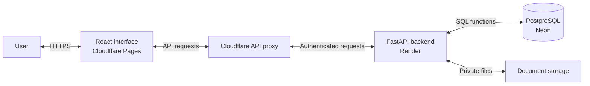
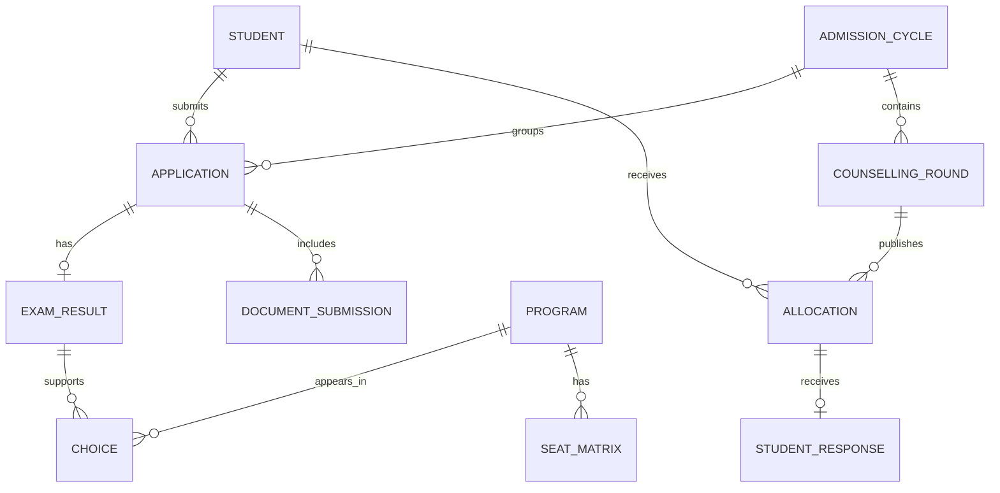
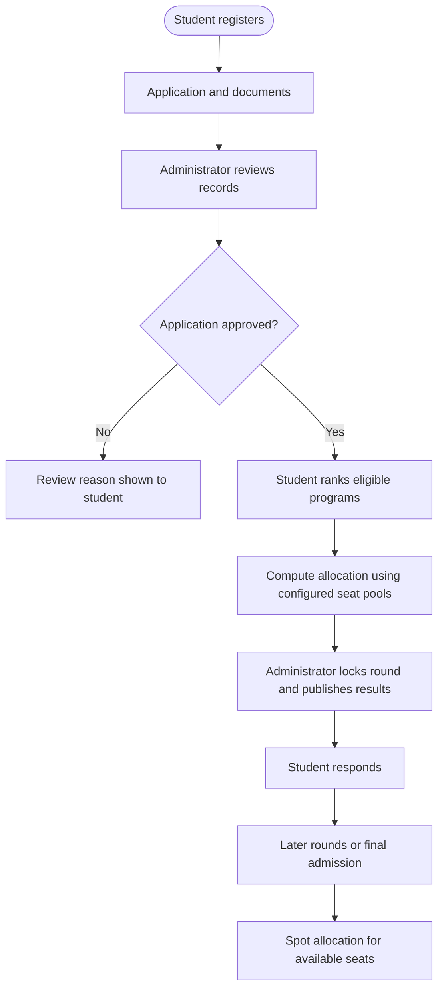
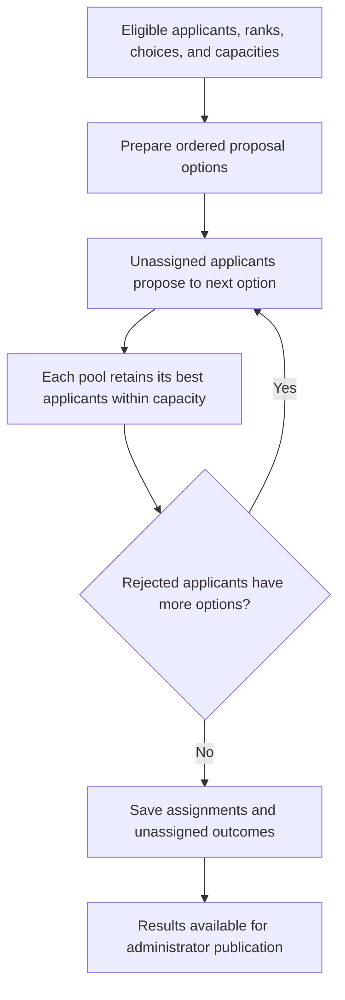

# College Admission Management System

## Project Report — V2

## 1. Introduction

The College Admission Management System is a web application that manages student applications, program preferences, seat allocation, and counselling rounds. It brings students and admission staff onto one platform and stores admission records in a PostgreSQL database.

The project demonstrates how DBMS concepts such as relational design, constraints, stored functions, transactions, and access control can support a practical admission process. It uses synthetic student data for academic demonstration.

## 2. Problem Statement and Objectives

Managing admissions through spreadsheets and manual records can cause duplicate entries, inconsistent seat counts, and difficulty tracking student decisions. A centralized system helps organize this information and apply admission rules consistently.

The project aims to:

- Maintain student applications, examination results, documents, and seat availability.
- Allocate seats according to eligibility, ranks, and student preferences.
- Support multiple counselling rounds and student responses.
- Provide separate interfaces for students, administrators, analysts, and auditors.
- Preserve admission history and prevent conflicting seat assignments.

## 3. Technology and Architecture

| Component | Technology | Purpose |
|---|---|---|
| Frontend | React, TypeScript, Vite | Forms, dashboards, and role-based navigation |
| Backend | Python and FastAPI | Authentication, request handling, and document access |
| Database | PostgreSQL | Admission records, allocation rules, and data integrity |
| Frontend hosting | Cloudflare Pages | Serves the interface and proxies API requests |
| Backend hosting | Render | Runs the FastAPI service |
| Database hosting | Neon | Hosts PostgreSQL and private document storage |

**Figure 1. System architecture**

The frontend displays information and collects input. FastAPI authenticates users and calls approved database functions. PostgreSQL applies admission rules and stores the results. Uploaded documents are held in private storage, with their metadata recorded in the database.

## 4. User Roles and Features

| Role | Main features |
|---|---|
| Student | Submit an application, upload documents, rank programs, view chances and allocations, and respond to results |
| Administrator | Review applications, manage exam results and seat capacity, configure rounds, publish allocations, and confirm admissions |
| Analyst | Explore saved simulations and compare changes in capacity or student participation |
| Auditor | Inspect audit events and historical seat-capacity records |

Additional features include CSV imports, mock allotments, historical cutoff information, an administrator Overview dashboard, and spot-seat availability.

## 5. Database Design

The database separates permanent student information from records that change each admission year. This allows one student to have applications and examination results for different cycles without duplicating their identity record.

| Main tables | Information stored |
|---|---|
| `student`, `app_user` | Student identity and user accounts |
| `admission_cycle`, `application`, `exam_result` | Annual admission settings, applications, marks, and ranks |
| `program`, `seat_matrix`, `choice` | Programs, category-wise capacity, and ranked preferences |
| `counselling_round`, `allocation`, `student_response` | Rounds, published seats, and student decisions |
| `seat_holding`, `final_admission` | Current holdings and confirmed admissions |
| `document_submission` | Document metadata and review status |
| `sim_input_snapshot`, `sim_run`, `sim_result` | Saved simulation inputs and outcomes |
| `spot_pool`, `spot_acceptance` | Available spot seats and acceptance records |
| `audit_ledger`, `seat_matrix_history` | Event history and changes in capacity |

Primary keys identify records, while foreign keys connect related tables. Composite keys represent annual records and seat pools. UNIQUE constraints prevent duplicate preferences and conflicting holdings; CHECK constraints restrict marks, capacity, and valid statuses.

The core relational design follows normalization principles to reduce duplication. Simulation snapshots and historical results deliberately retain copies of information so earlier outcomes remain reproducible.

**Figure 2. Core database relationships**

One student can apply in multiple years. Each application can have several documents and preferences. The diagram shows the main relationships; supporting tables are omitted for clarity.

## 6. Admission and Allocation Workflow

**Figure 3. Admission process**

The allocation engine uses deferred acceptance: applicants propose to eligible options in preference order, and each seat pool retains its highest-priority applicants within capacity. OPEN seats use common rank, while reserved pools use category rank.

**Figure 4. Seat allocation logic**

| Student decision | Meaning |
|---|---|
| FREEZE | Keep the assigned seat |
| FLOAT | Seek a more preferred program in a later round |
| SLIDE | Seek a more preferred program within the same institute |
| WITHDRAW | Leave the admission process |

## 7. DBMS Concepts and Security

Stored functions implement admission rules, allocation, and dashboard queries. Triggers record audit events, preserve capacity history, and guard choice changes. Views and aggregate queries support reports and historical cutoff analysis.

Transactions keep related updates together. Locks and guarded capacity updates prevent simultaneous requests from consuming the same remaining seat. Request identifiers help prevent duplicate processing when an operation is retried.

Passwords are protected using Argon2 hashing. Sessions, CSRF protection, and role checks control access to the API. The application database role uses approved functions instead of directly modifying tables. Documents remain private and are retrieved through authorized requests.

## 8. Conclusion

The College Admission Management System combines a web interface with database-enforced admission rules. It organizes applications, preferences, counselling decisions, and seat assignments while demonstrating relational modeling, integrity constraints, transactions, and access control. The project provides a practical foundation for an admission platform within its implemented fixed-pool policy.

**Application:** [college-admission-164.pages.dev](https://college-admission-164.pages.dev/)
