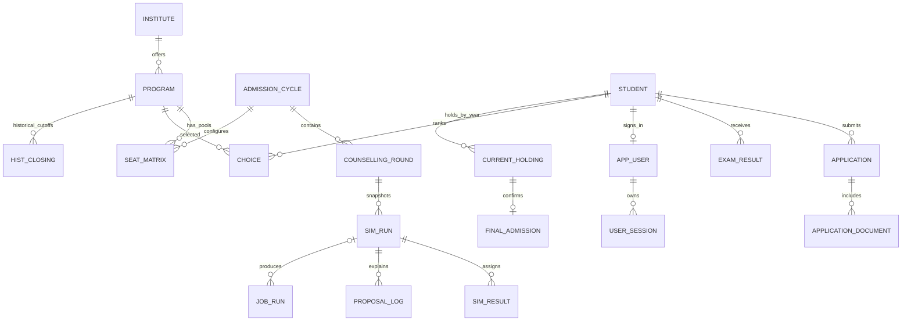

# Entity relationships

Annual application/exam/holding identity uses year and student. Program identity includes its institute; pools use program/year/category. Unique and foreign-key constraints enforce boundaries. Immutable snapshots make replay independent of live edits. Audit events/system-time seat history track changes; prediction materialized views are derived caches. Exact columns and types are in the generated data dictionary and schema.
