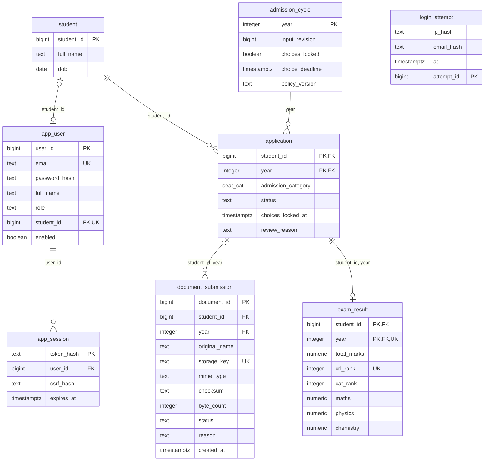
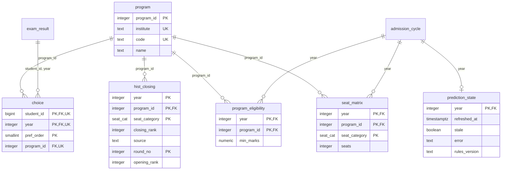
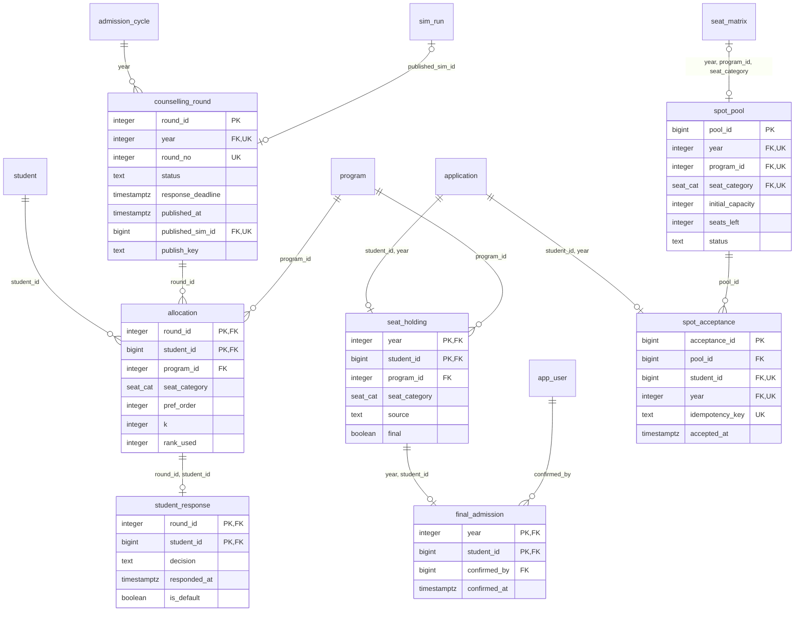
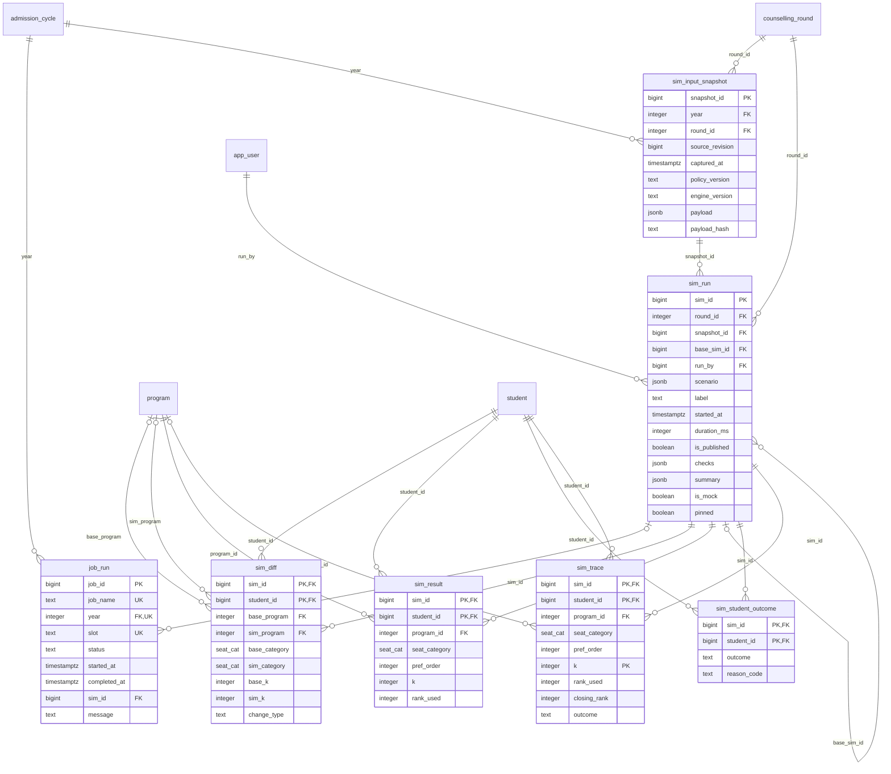
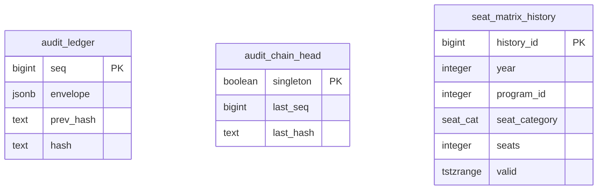

# Entity relationships

Generated from the migrated schema by `npm run docs:er` (`backend/app/er_diagram.py`). Do not edit by hand; change a migration and regenerate.

The `admission` schema has 31 tables. Each diagram covers one area; a table from another area appears by name only. Each relationship is drawn in the area of the table holding the foreign key. `PK` marks primary-key columns, `FK` foreign-key columns and `UK` columns in a unique constraint.

Relationship notation: `||--o{` one to many, `||--o|` one to zero-or-one. A composite key such as `(student_id, year)` gives one row per student per admission cycle.

## Identity and applications

Who applies, how they sign in, and what they submit for each annual cycle.

## Programs, seats and choices

What can be chosen, how many seats each pool has, and each ranked choice.

## Rounds and outcomes

Published rounds, student responses, the seat each student holds, and the spot round.

## Simulation and replay

Immutable input snapshots, every allocation run, its results and explanations.

## Audit and history

The hash-chained event ledger and the system-time history of seat capacity.

